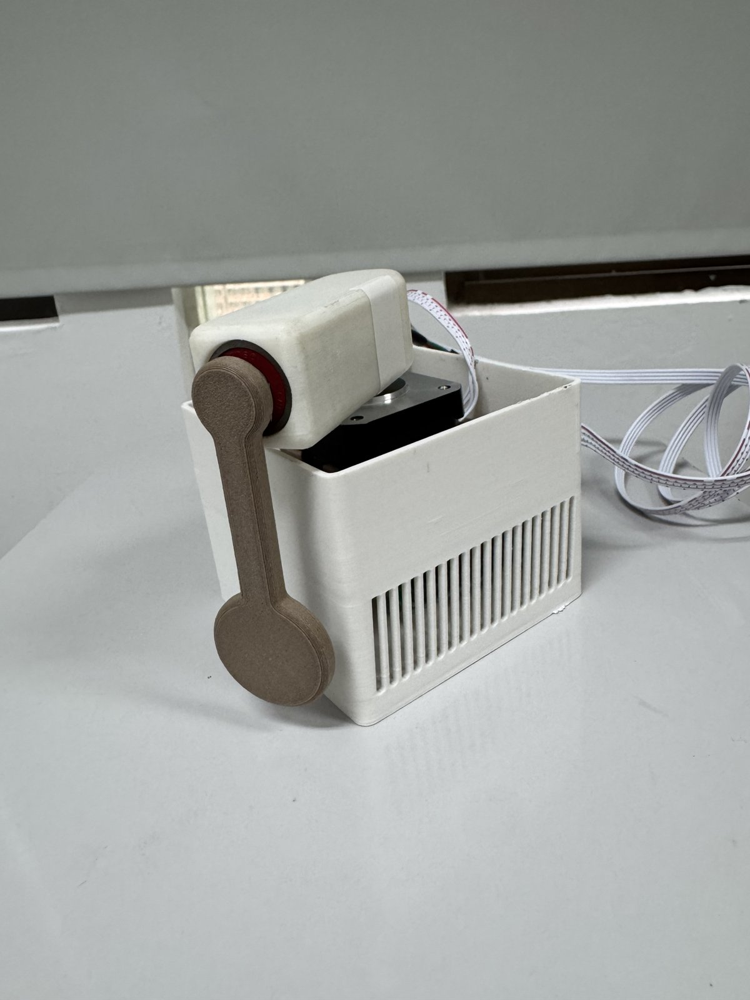
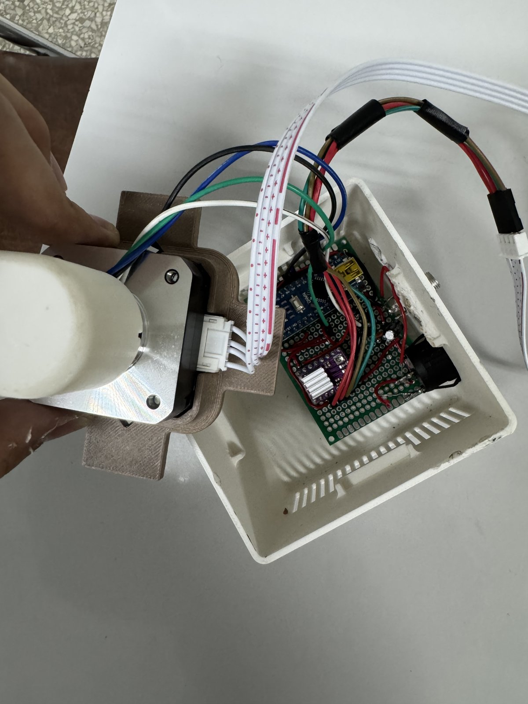
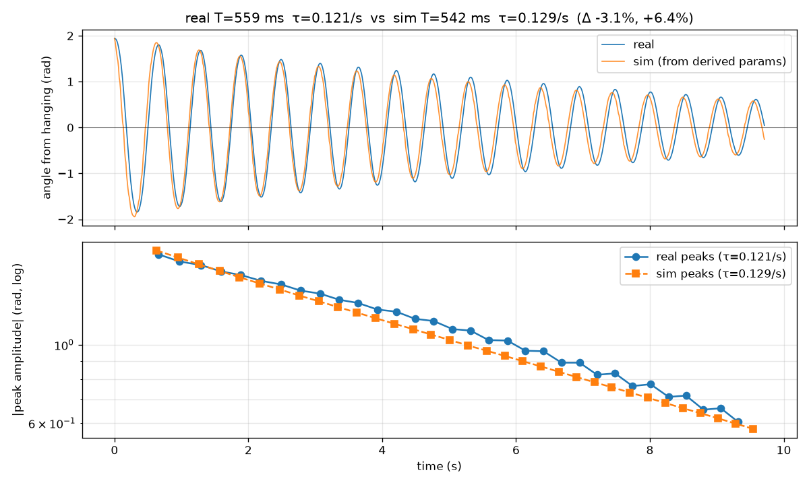
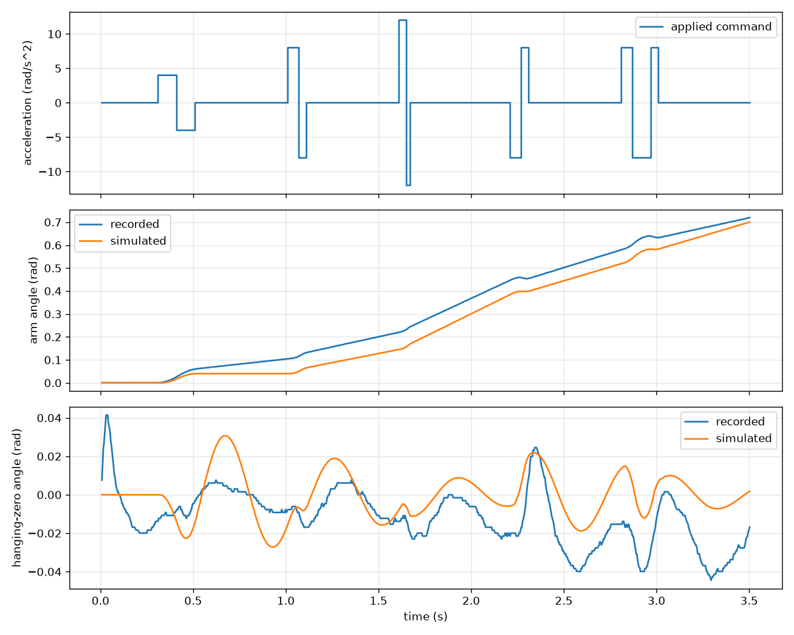
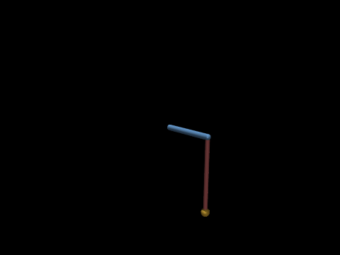
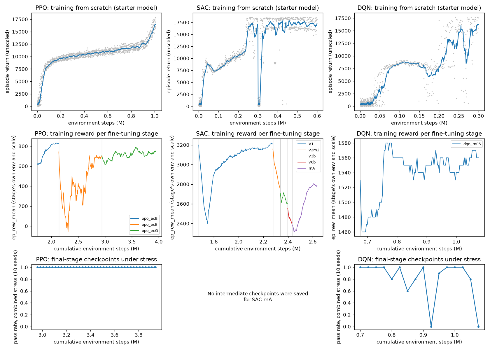

# RPL HW1 Group08 Report

Videos of the real pendulum are in the team's Google Drive folder
[HW1 Videos](https://drive.google.com/drive/folders/1CFDbcyvU7opS-w7kURgxEyHXty3lUq4k?usp=sharing).

**Team members:** LIN LIANG-CHIN, MARIO FENG WU, CHENG YU-SHIANG, YU HSIN-LUN

## Contents

- [RPL HW1 Group08 Report](#rpl-hw1-group08-report)
  - [Contents](#contents)
  - [1. Summary](#1-summary)
  - [2. Assembly (10%)](#2-assembly-10)
    - [2.1 Parts](#21-parts)
    - [2.2 Build steps and photos](#22-build-steps-and-photos)
    - [2.3 Commissioning checks](#23-commissioning-checks)
    - [2.4 Problems Encountered \& Resolutions](#24-problems-encountered--resolutions)
  - [3. System identification (15%)](#3-system-identification-15)
    - [3.1 Videos of the process](#31-videos-of-the-process)
    - [3.2 Procedure](#32-procedure)
    - [3.3 Identified parameters](#33-identified-parameters)
    - [3.4 Validation](#34-validation)
    - [3.5 Limitations](#35-limitations)
  - [4. Model and A, B derivation](#4-model-and-a-b-derivation)
  - [5. Swing-up logic for the classical controllers (7%)](#5-swing-up-logic-for-the-classical-controllers-7)
    - [5.1 Hardware version: learned swing-up with a capture gate](#51-hardware-version-learned-swing-up-with-a-capture-gate)
    - [5.2 Earlier version: energy shaping](#52-earlier-version-energy-shaping)
    - [5.3 Why swing-up time matters](#53-why-swing-up-time-matters)
  - [6. Evaluation protocol](#6-evaluation-protocol)
  - [7. Results per algorithm (5% × 7)](#7-results-per-algorithm-5--7)
    - [7.1 PID](#71-pid)
    - [7.2 LQR](#72-lqr)
    - [7.3 iLQR](#73-ilqr)
    - [7.4 MPC](#74-mpc)
    - [7.5 PPO](#75-ppo)
    - [7.6 SAC](#76-sac)
    - [7.7 DQN](#77-dqn)
  - [8. Comparison of all seven algorithms](#8-comparison-of-all-seven-algorithms)
  - [9. Sim-to-real differences](#9-sim-to-real-differences)
  - [10. Live demonstration](#10-live-demonstration)
  - [11. AI usage and reflection (5%)](#11-ai-usage-and-reflection-5)
    - [11.1 Representative interactions (2.5%)](#111-representative-interactions-25)
    - [11.2 Reflection (2.5%)](#112-reflection-25)
  - [12. Reproduction and files](#12-reproduction-and-files)

---

## 1. Summary

| Category | Algorithm | Hardware passes / attempts | Best hardware run | Continuous balance | Simulation (identified rig) |
| --- | --- | ---: | --- | ---: | --- |
| Classical | PID | 1 / 8 | [`20261107_161650`](docs/results/hardware/pid/20261107_161650/) | 10.42 s | Pass |
| Classical | LQR | 4 / 18 | [`20261107_030202`](docs/results/hardware/lqr/20261107_030202/) | 12.84 s | Pass |
| Classical | iLQR | 1 / 10 | [`20261107_161026`](docs/results/hardware/ilqr/20261107_161026/) | 13.26 s | Pass |
| Classical | MPC | 1 / 28 | [`20261107_155613`](docs/results/hardware/mpc/20261107_155613/) | 10.66 s | Pass |
| Learning | PPO | 3 / 17 | [`20261109_013508`](docs/results/hardware/ppo/20261109_013508/) (report run, ppo_ecG) | 13.14 s | Pass |
| Learning | SAC | 2 / 12 reward-trained (see note) | [`20261109_004713`](docs/results/hardware/sac/20261109_004713/) (report run, rnA) | 13.12 s | Pass |
| Learning | DQN | 2 / 4 | [`20261109_010341`](docs/results/hardware/dqn/20261109_010341/) (report run, dqn_rn05) | 13.56 s | Pass |

- **All seven controllers passed the full 15 s hanging-start task on the real pendulum**: the four classical ones on 2026-11-07, PPO, SAC and DQN on 2026-11-09. Each learned policy does its own swing-up and balance, with no classical code at run time.
- Attempts are counted, failures included. The run tables in [docs/results/hardware/](docs/results/hardware/README.md) list every attempt with the reported presets and checkpoints and their direct predecessors; earlier development attempts with experimental presets or checkpoints, all failed, are documented separately (§6). Pass rates are low for every method (roughly one attempt in five or six for the classical controllers' final presets), so a single pass shows the method *can* work on this rig, not that it is reliable.
- The learned controllers failed on hardware until 2026-11-09. Two changes came together: the pendulum, which had come loose on its shaft, was re-secured, and the policies were fine-tuned with rig-like sensor noise (and, for PPO, a fix for a spinning reward exploit). We cannot fully separate the two effects (§9).
- **SAC note.** The SAC run index lists 3 passes in 13 attempts. One of them (P1, [`20261107_215833`](docs/results/hardware/sac/20261107_215833/)) used a policy whose balancing was learned by imitating LQR's commands, so we do not count it; the counted result is reward-trained SAC, 2 of 12 ([§7.6](#76-sac)).

---

## 2. Assembly (10%)

### 2.1 Parts

The rig follows the course kit and [`docs/hardware.md`](docs/hardware.md):

| Item | Specification | Variation from the kit list |
| --- | --- | --- |
| Microcontroller | Arduino Nano (ATmega328P), USB-C | Arduino Nano V3.0, Mini-USB |
| Stepper motor | NEMA17 17HS4023 | - |
| Stepper driver | DRV8825, 1/32 microstepping (M0/M1/M2 high) | - |
| Encoder | AS5600 magnetic encoder with diametric magnet | - |
| Power | 12 V adapter, 5.5 × 2.1 mm barrel jack, power switch | - |
| Board | 40 × 60 mm protoboard, ceramic and electrolytic capacitors | 50 x 70 mm protoboard, capacitors are the same |
| Bearing | Bones Reds 608 (8 × 22 × 7 mm) | - |
| 3D-printed parts | Pendulum, arm, motor plate, case | re-printed arm (with larger slot for encoder wiring) |
| Tip mass | NT$10 coin sealed in the pendulum pocket | - |

Measured pendulum: total mass **0.014 kg** and COM distance **0.051 m**, as entered in
[`configs/my_rig.json`](configs/my_rig.json). 
The arm radius is 0.065 m (CAD).

### 2.2 Build steps and photos

1. Checked each module before soldering.
2. Soldered header pins for the Nano and the DRV8825, then the remaining wiring following the course wiring diagram.
3. Checked continuity and shorts with a multimeter, unpowered.
4. Set the DRV8825 current limit to **Vref = 0.45 V** before the motor ever ran.
5. Sanded down the encoder groove to make it slightly wider. Mounted the encoder on the arm, the magnet on the pendulum, the bearing in the arm, and the pendulum on the bearing.
6. Final assembly in the case.

| Finished rig | Inside the case |
| --- | --- |
|  |  |
| Arm on the stepper motor, bearing and pendulum mounted, encoder cable leaving the arm. | Motor and plate lifted out: the protoboard with the Arduino Nano, the DRV8825 (with heatsink) and the DC jack, and the motor and encoder wiring. |

### 2.3 Commissioning checks

We consolidated the scattered test steps into [first-start checklist](docs/first-start-checklist.md) and ran checks according to it:

| Check | Result |
| --- | --- |
| Firmware flashed (`TestHeartbeat`, `TestEncoder`, `LowLevelServer`) | PlatformIO with `pio` commands |
| USB heartbeat, 12 V off | Heartbeat #1, Heartbeat #2, ... with LED light flashing correspondingly |
| Encoder: magnet strength reported "just right" | Magnetic detected, reported "just right", outputed pendulum degrees |
| Encoder: still-pendulum noise | Within 1 count (0.088°) in balance data (see [§9](#9-sim-to-real-differences)) |
| Physical +30° check (+533 microsteps commanded) | Motor moved correspondingly |
| Firmware profile | 50 Hz, 32 microsteps, 500000 baud, ±100° arm guard, 6 rad/s speed guard (from `run.json`) |
| Free-swing behavior | Lightly damped: ζ ≈ 0.010, amplitude shrinks about 3% per half-cycle (see [§3](#3-system-identification-15))  |

### 2.4 Problems Encountered & Resolutions

| Problem Description | Root Cause | Resolution / Fix |
|-|-|-|
|Driver, encoder, and Nano were all burned out.|**Short circuit** while testing with a multimeter.|Purchased replacement components and tested with extra caution.
|Passed **preflight** but failed **motor-check**|Poor solder joints on the 4 **motor wires**.|Resoldered the relevant circuits.
|Encoder safety faults (firmware fault bits = 2) stopped several runs on 11/7–11/8, and once the pendulum reading froze at 179.9° while the arm moved.|Unreliable encoder reading; a weak or intermittent magnet/encoder connection is the likely cause.|Repaired the encoder on 11/8 (no faults in the following 8 episodes); added [`firmware/TestMagnitude`](firmware/TestMagnitude/TestMagnitude.ino) to watch magnet strength and read errors live.
|Around midnight 11/8–11/9 **every controller failed, LQR included** (about 20 LQR runs, best 4.5 s), with the balance tilt changing from run to run (−0.7° to +2.9°).|The **pendulum had come loose** relative to its shaft and magnet. The swing-up's second peak had crept from about 59° (11/7) to about 68°, so it may have been loosening for a while.|Re-secured the pendulum (about 00:42 on 11/9); LQR again held 7.7 s with −0.4° tilt. Runs from before the fix, including the earlier learned-policy failures, were probably affected.


---

## 3. System identification (15%)

### 3.1 Videos of the process

| Clip | Shows | Link |
| --- | --- | --- |
| IMG_2990 | Free swing (12 V off): arm held still, pendulum released from about 107° and left to swing freely for 10 s. These recordings fit the pendulum parameters (sysid_train_01) and validate them on held-out releases (sysid_holdout_01). | [Drive](https://drive.google.com/file/d/1oWhUqe_Gy7Fa0Bi2E3sonRsoBW9ZvRv0/view) |
| IMG_2991 | Free swing (12 V off), another release from about 107°. | [Drive](https://drive.google.com/file/d/110uhCH10uAySGvTrN89_16Gc_1I7Si4g/view) |
| IMG_2992 | Driven-response test: hanging zero with 12 V off, then 12 V on; the arm makes small left–right acceleration moves and the pendulum sways slightly. Compares the real arm and pendulum response with the simulator ([driven result](docs/results/sysid/driven/)). | [Drive](https://drive.google.com/file/d/1AXOVtkZ6ZOqQyVXyL8T7xzjqR3a0y5wM/view) |
| IMG_2994 | Driven-response test, same procedure with a different command pattern. | [Drive](https://drive.google.com/file/d/1uu94O3TVziQuVyjbtQDxClaCiWONHEpB/view) |
| IMG_2996 | Tare: arm centered, pendulum hanging still, 12 V off; the tool records the hanging zero | [Drive](https://drive.google.com/file/d/1XuEbrjGsXCvJZXbaN3F_46zrN6dOtZ_0/view) |
| IMG_2997 | Driven-response test continuing from IMG_2996: small arm moves, slight pendulum sway. | [Drive](https://drive.google.com/file/d/1tczMpPRqRkza07X9maMiPrDcUWq6nb_p/view) |


### 3.2 Procedure

We used the supplied workflow ([guide](docs/system-identification.md)) with little changing of code.

1. **Tare and free swing (12 V off).** Arm held still, pendulum released from about 107° (1.86 rad) by sliding a support away. Three 10 s free swings at 100 Hz:
   ```bash
   pendulum-lab sysid --port /dev/ttyUSB0 --out-dir runs/sysid_train_01 --out-json configs/my_rig.json
   ```
2. **Held-out free swings.** Three more swings from different releases, not used for fitting, then validation with frozen parameters:
   ```bash
   pendulum-lab sysid collect --port /dev/ttyUSB0 --skip-motor --out-dir runs/sysid_holdout_01
   pendulum-lab sysid validate --in-dir runs/sysid_holdout_01 --params configs/my_rig.json --out-dir runs/sysid_validation_01
   ```
3. **Driven response (motor powered).** Acceleration step and chirp, motor-envelope sweeps, and a coupling fit (`sysid accel`, `sysid motor-envelope`, `sysid fit-coupling`).
4. **Mass.** Weighed pendulum mass written to `run_meta.pendulum_total_mass_kg`. COM and COM inertia come from the CAD model (`src/pendulum_lab/plant/data/model.urdf`).

Raw data and outputs: [`docs/results/sysid/`](docs/results/sysid/README.md).

### 3.3 Identified parameters

From [`configs/my_rig.json`](configs/my_rig.json) (sha256 `14d0eab5…4e80f`, used by every hardware run):

| Quantity | Value | Spread over 3 runs |
| --- | --- | --- |
| Pendulum mass m | 0.014 kg | — |
| COM distance l | 0.051 m (CAD) | — |
| Pivot inertia J (from period) | 4.653 × 10⁻⁵ kg·m² | CAD prediction 4.447 × 10⁻⁵ (+4.6%) |
| Small-amplitude natural frequency ωₙ | 12.27 rad/s | ±0.065 |
| Small-amplitude period | 0.512 s | ±0.003 |
| Large-amplitude period | 0.556 s | ±0.001 |
| Damping ratio ζ | 0.0101 | ±0.0003 |
| Viscous friction | 1.02 × 10⁻⁵ N·m·s | — |
| Coulomb friction | 9.4 × 10⁻⁶ N·m | — |
| Rest angle offset | 0.018 rad | — |

The decay envelope fits much better with Coulomb plus viscous friction (RMSE 0.016 rad)
than with viscous friction alone (0.049 rad), so both terms are kept.
Check: √(mgl/J) = √150.5 = 12.27 rad/s, the measured small-amplitude ωₙ.

### 3.4 Validation

| Data | Used for fitting? | Angle RMSE vs. simulator |
| --- | --- | --- |
| Training swing 1 (10 s) | Yes | 1.39 rad |
| Held-out swing 1 | No | 0.31 rad |
| Held-out swing 2 | No | 0.28 rad |
| Held-out swing 3 | No | 0.23 rad |



In the training comparison the period (540 ms vs 540 ms, −0.1%) and decay rate (−2.8%) match almost exactly. Its large RMSE (1.39 rad) comes from the start time: the real pendulum rests on the support for about 0.3 s before release, while the simulation starts swinging at t = 0, so the two curves are out of phase from the start. The held-out comparisons start the simulation at the detected release. They agree closely at first, but the simulated period is about 3% shorter (542 vs 559 ms in swing 1), so the curves drift out of phase over 10 s; this drift accounts for most of the 0.23–0.31 rad RMSE. The decay rate is within about 6%. The model therefore captures the pendulum's natural frequency and damping well enough for controller design. Its main error is a small period mismatch at large amplitudes, which matters little near upright, where the balance controller works.

**Driven-response checks** ([details](docs/results/sysid/README.md#driven-response-recordings-motor-powered)):

| Experiment | Result |
| --- | --- |
| Acceleration step (scale 0.08) | Arm RMSE vs. simulator 0.054 rad |
| Coupling fit (`envelope_01`, 1.5 rad/s, 25 rad/s²) | Coupling 0.93 of the model, R² 0.86, 67 samples |
| Motor envelope (2.5 rad/s, 30 rad/s²) | Passed; peak measured 3.25 rad/s |
| Envelope sweeps at 50 rad/s² up to 4.5 rad/s | Arm reaches 5.1 rad/s; pendulum swings up to 75° |
| Arm acceleration tracking | 50–53 rad/s² measured for 50 commanded |



### 3.5 Limitations

- Free swings do not identify transport delay or motor torque. The controller delays (15 ms arm, 25 ms pendulum) were estimated later from hardware balance logs (§9).
- Mass and COM are not fitted; they come from weighing and CAD.
- Driving a pendulum model with the measured arm motion suggests more damping while the arm moves (about 1.0 s⁻¹, against 0.22 s⁻¹ from free swings) and coupling about 0.85 of the model. These values did not improve the simulator overall, so `my_rig.json` was not changed.
- An earlier identification on the same evening ([backup](docs/results/sysid/earlier_session_20261106_2110/)) differs mainly in Coulomb friction (8.7 × 10⁻⁷ against 9.4 × 10⁻⁶ N·m).

---

## 4. Model and A, B derivation

**Conventions.** State x = [φ, θ, φ̇, θ̇]ᵀ with θ = 0 upright. The lab commands arm
acceleration directly, φ̈ = u = 50 v with normalized action v ∈ [−1, 1], so the arm
inertia drops out. The simulator measures θ in the opposite direction from the lecture,
so we substitute θ → −θ in the lecture equations ([assignment](docs/assignment.md#controller-interface)).

Nonlinear model (lecture equations with this substitution):

```
φ̈ = u
θ̈ = (mgl/J) sin θ + (m r l/J) cos θ · u + sin θ cos θ · φ̇² − (b_θ/J) θ̇
```

**Linearization** about upright (sin θ ≈ θ, cos θ ≈ 1; the φ̇² term is second order and drops out):

```
θ̈ ≈ a θ + b u − d θ̇,   a = mgl/J,   b = m r l/J,   d = b_θ/J
```

```
    ┌ 0  0  1   0 ┐            ┌ 0 ┐
A = │ 0  0  0   1 │     B = 50 │ 0 │
    │ 0  0  0   0 │            │ 1 │
    └ 0  a  0  −d ┘            └ b ┘
```

**Numbers** for our rig (m = 0.014 kg, l = 0.051 m, r = 0.065 m, J = 4.653 × 10⁻⁵ kg·m²,
b_θ = 1.018 × 10⁻⁵ N·m·s, g = 9.81 m/s²):

| Term | Value |
| --- | --- |
| a = mgl/J | 150.5 s⁻² |
| b = mrl/J | 0.997 |
| d = b_θ/J | 0.219 s⁻¹ |
| B | [0, 0, 50, 49.9]ᵀ |

A has an unstable eigenvalue at +√a ≈ +12.2 s⁻¹ (the inverted pendulum).

**Discretization.** Zero-order hold at Δt = 0.02 s (50 Hz). The hardware presets also
model input delay by adding past commands to the state: 15 ms before the arm responds and
25 ms before the pendulum responds (`balance_model` in [`lqr.py`](src/pendulum_lab/algorithms/lqr.py)).


---

## 5. Swing-up logic for the classical controllers (7%)

All four classical controllers use the **same swing-up and hand-off layer**. Each of
`lqr.py`, `mpc.py`, `ilqr.py` and `pid.py` carries an identical copy (the assignment keeps
each algorithm in its own file; [`tests/test_handoff_sync.py`](tests/test_handoff_sync.py) checks the copies match).
**Only the balance command differs between algorithms**, so the graded algorithm does the balancing (slide 13).

### 5.1 Hardware version: learned swing-up with a capture gate

```
hanging ──► SAC swing-up policy ──► capture gate ──► balance (PID / LQR / iLQR / MPC)
                ▲                                          │
                └──────────── release if |θ| > 0.55 rad ◄──┘
```

1. **Swing-up.** A SAC policy ([`sac_focused_policy.zip`](docs/results/sac_focused_policy.zip), trained in simulation) pumps the pendulum from hanging toward upright (`"swing_up": "sac"`).
2. **Approach braking.** Near upright, swing-up commands are limited so the pendulum crosses at about 4.5 rad/s. The controller predicts the energy one tick ahead and limits the command only when it would add too much energy.
3. **Capture gate.** Balance starts only when all of these hold: |θ| < 0.45 rad, |θ̇| < 6 rad/s, |φ| < 0.8 rad, |φ̇| < 3 rad/s, and the first balance command |v| ≤ 1.0.
4. **Balance.** The algorithm's own law (§7) runs. Extra logic, used identically by all four:
   - **Arm recentering.** The arm reference starts at the capture position and moves to center at 0.35 rad/s.
   - **Velocity estimate.** Pendulum speed blends 45% of a three-point angle derivative with the firmware value, plus a model-based observer after capture.
5. **Release and retry.** If |θ| exceeds 0.55 rad, control returns to SAC swing-up (hysteresis: capture at 0.45, release at 0.55).
6. **Arm limiter (always on).** Commands are limited so the arm can stop before 1.42 rad and stay under 4.7 rad/s, allowing 15 ms of delay. This is inside the firmware guards (±100°, 6 rad/s).

Settings: [`docs/controller-settings.md`](docs/controller-settings.md).

**Why a learned swing-up is allowed here, and where the code lives.** The assignment permits any swing-up
method for the classical controllers, "even a hard-coded one", provided the graded algorithm does the balancing.
The SAC network only pumps energy until the capture gate fires; from capture onward every command comes from
the file's own balance law (PID, LQR, iLQR or MPC), and control goes back to the swing-up only after a release.
All of the hand-off logic (approach braking, capture gate, recentering, observer, release, arm limiter) is inside
each controller's own file. The only thing imported is the policy itself, through the SAC `Controller` class in
[`sac.py`](src/pendulum_lab/algorithms/sac.py), so the swing-up network is not reimplemented four times. The
energy-shaping swing-up (§5.2) is implemented in each file as well, so every classical controller still runs
with no SAC checkpoint at all.

### 5.2 Earlier version: energy shaping

Without a SAC checkpoint the same layer uses energy shaping. Normalized energy is
E/J = θ̇²/2 + a cos θ; the command pumps energy with sign θ̇ cos θ, adds arm centering
and damping, and gives a small alternating kick (12 rad/s² every 25 ticks) to leave
exact hanging rest. An adaptive version adjusts the energy target after each pass.
It passed in simulation, but on hardware the energy-shaping presets held at most **2.24 s**
([configs/experiments/README.md](configs/experiments/README.md)), so we switched to the learned swing-up.

### 5.3 Why swing-up time matters

Swing-up time (first capture) on the passing runs: LQR 2.09 s, iLQR 1.67 s, MPC 4.23 s,
PID 4.29 s. With 15 s per run, balance must start before 5 s to leave the final 10 s balanced.


---

## 6. Evaluation protocol

- **Full-task metric** (slide 13): start with the arm centered and the pendulum hanging still; run 15 s with no safety stop; for the whole final 10 s, |θ| ≤ 15° and |θ̇| ≤ 4 rad/s.
- **Simulation** uses the true state; **hardware** uses the encoder and step count.
- **Hanging start vs. near-upright start** are reported separately. Near-upright starts randomize θ within about 17° and the arm within 5°; they only test local balance.
- **Seeds.** Development used fixed seeds (e.g. 0, 10000–10009; classical stress batch 40000+; RL held-out test 71000–71019 for the earlier `*_long` checkpoints). The standard simulator's hanging start is **exact** (`exact_hanging_reset_frac = 1.0` in [`environment.py`](src/pendulum_lab/environment.py)), so every seed gives the same hanging-start episode. Re-running the seed-0 episode on 50 other seeds reproduced it bit for bit, which means a held-out hanging-start test needs randomness. The **final evaluation** therefore used seeds never used in development, with the final presets and checkpoints ([`scripts/report_sim_eval.py`](scripts/report_sim_eval.py)):
  - **Near-upright** (classical controllers only): 20 random upright starts, seeds 93000–93019 ([`report_sim_upright.json`](docs/results/report_sim_upright.json)).
  - **Held-out stress batch** (all seven): the randomized cases of [`transfer_stress.py`](scripts/transfer_stress.py) (varied starts, 20/30 ms delay, mild sensor noise, and a combined case that also changes friction, inertia and motor limits), seeds 92000–92009 ([`report_sim_stress.json`](docs/results/report_sim_stress.json)). The two delay cases have no per-seed randomness, so each counts as one episode: 32 distinct episodes per method.
- **Hardware.** Attended runs, 15 s, rig model `configs/my_rig.json`. Replaying the recorded observations through the current code reproduces every command on the classical passing runs ([`tests/test_hardware_replay.py`](tests/test_hardware_replay.py)).
- **Commissioning (3 s before 15 s).** The first powered controller runs were short: LQR at 3 s (`lqr_hw_01`, 2026-11-06 21:29, ran to the end with no guard stop), then 5 s and 8 s runs, and further 3 s checks after changes (`lqr_hw_11`, `lqr_hw_12`); MPC also had a 3 s run (`031251`) before its 15 s attempts. 15 s runs started after these; the first 15 s LQR pass was at 02:57 on 11/7. None of the 13 short runs balanced for long (best hold 2.24 s), and they are not counted as full-task attempts, since a run shorter than 15 s cannot pass. They are kept in [`docs/results/hardware/commissioning/`](docs/results/hardware/commissioning/README.md).
- **Which attempts are counted.** The hardware indexes keep every attempt, including faults, made with the presets and checkpoints reported in §7 and their direct predecessors; the pass rates in this report come from them. Earlier development attempts were not promoted to the indexes, and all of them failed: about 26 LQR attempts with experimental presets and 5 MPC attempts with earlier presets ([configs/experiments/README.md](configs/experiments/README.md)), and about 20 official-runner attempts with intermediate SAC versions (v2m2, v3b, v3c, v6b, and one rnA run before the pendulum was re-secured), plus further experimental SAC versions ([docs/sac-reward-curriculum.md](docs/sac-reward-curriculum.md), [docs/sac-hardware-pass.md](docs/sac-hardware-pass.md)).

---

## 7. Results per algorithm (5% × 7)

Real-pendulum videos are in the [Drive folder](https://drive.google.com/drive/folders/1CFDbcyvU7opS-w7kURgxEyHXty3lUq4k?usp=sharing).

**About the simulator GIFs.** Each GIF is one deterministic 15 s hanging-start episode in the standard
simulator on the **identified rig** (`configs/my_rig.json`), seed 0, with **the same preset and checkpoint
as the hardware video next to it**. All seven pass the full-task metric. Commands and metrics:
[`report_sim_my_rig.json`](docs/results/report_sim_my_rig.json) (classical) and
[`report_rl_passes.json`](docs/results/report_rl_passes.json) (PPO, SAC, DQN). For example:

```bash
pendulum-lab sim --algorithm lqr --params configs/my_rig.json \
  --config configs/lqr_my_rig_coupling_delay.json \
  --checkpoint docs/results/sac_focused_policy.zip \
  --start hanging --duration 15 --seed 0 --gif --output runs/report_gif/lqr
```

| Simulator, seed 0 | PID | LQR | iLQR | MPC | PPO (ecG) | SAC (rnA) | DQN (rn05) |
| --- | ---: | ---: | ---: | ---: | ---: | ---: | ---: |
| Result | Pass | Pass | Pass | Pass | Pass | Pass | Pass |
| First within 15° of upright | 1.62 s | 1.62 s | 1.62 s | 1.62 s | 1.80 s | 2.14 s | 2.32 s |
| Longest continuous balance | 12.88 s | 12.88 s | 12.88 s | 12.88 s | 13.20 s | 12.84 s | 12.68 s |
| Final 10 s max \|θ\| | 0.52° | 0.60° | 0.50° | 0.37° | 5.56° | 0.32° | 0.93° |
| Final 10 s max \|θ̇\| | 0.15 rad/s | 0.20 rad/s | 0.14 rad/s | 0.20 rad/s | 1.53 rad/s | 0.10 rad/s | 0.47 rad/s |
| Max arm, whole run / final 10 s | 54.6° / 3.9° | 54.6° / 3.1° | 54.6° / 5.6° | 54.6° / 4.7° | 48.8° / 47.5° | 75.3° / 9.5° | 77.7° / 15.0° |
| Command RMS, whole run / final 10 s | 0.284 / 0.080 | 0.284 / 0.083 | 0.285 / 0.085 | 0.284 / 0.086 | 0.838 / 0.846 | 0.253 / 0.041 | 0.439 / 0.360 |

The four classical controllers share the SAC swing-up and the capture gate (§5), and near upright their
balance commands are nearly identical, so in the noise-free simulator they catch at the same moment and
give the same balance time; they differ only in the small residual motion. Among the learned policies, SAC
holds most still; DQN's 5-level action set (steps of 25 rad/s²) makes it switch between levels while
balanced; PPO keeps large commands and a wide arm swing even in simulation. The simulator is far calmer
than the rig (§9): on hardware every controller wobbles by several degrees.

**Held-out stress batch** (seeds 92000–92009, never used in development; same presets and checkpoints;
full-task metric, 15 s; see §6). Passes per case; the two delay cases are deterministic and count once.

| Simulator stress, held out | PID | LQR | iLQR | MPC | PPO (ecG) | SAC (rnA) | DQN (rn05) |
| --- | ---: | ---: | ---: | ---: | ---: | ---: | ---: |
| Varied starts | 10/10 | 10/10 | 10/10 | 10/10 | 10/10 | 10/10 | 10/10 |
| 20 ms delay | 1/1 | 1/1 | 1/1 | 1/1 | 1/1 | 1/1 | 1/1 |
| 30 ms delay | 1/1 | 1/1 | 1/1 | 1/1 | 1/1 | 1/1 | **0/1** |
| Mild sensor noise | 10/10 | 10/10 | 10/10 | 10/10 | 9/10 | 10/10 | 10/10 |
| Combined | 10/10 | 10/10 | 10/10 | 10/10 | 10/10 | 10/10 | **1/10** |
| **Total (distinct episodes)** | **32/32** | **32/32** | **32/32** | **32/32** | **31/32** | **32/32** | **22/32** |
| Safety stops | 0 | 0 | 0 | 0 | 0 | 0 | 0 |
| Max arm, any episode | 81° | 81° | 81° | 78° | 80° | 80° | 81° |

DQN is the only method that breaks down under stress: it fails with 30 ms of command delay, and in the combined
case (20 ms delay plus changed friction, inertia and motor limits). It was fine-tuned with delays of 6–20 ms only
(§7.7). The others pass every distinct episode except one PPO noise episode. None of this predicts hardware
success (§9), but it shows the final checkpoints are not tuned to the single seed-0 episode.

**Near-upright starts (local stabilization), classical controllers.** 20 upright starts, seeds 93000–93019
(pendulum within about 17° of upright, arm within 5°), 15 s, same presets. This uses the full controller, so
a start the balance law cannot hold is handed back to the swing-up.

| Simulator, near-upright | PID | LQR | iLQR | MPC |
| --- | ---: | ---: | ---: | ---: |
| Passes (full-task metric) | 15/20 | 15/20 | 15/20 | 15/20 |
| Passes with \|θ₀\| ≤ 11.7° | 12/12 | 12/12 | 12/12 | 12/12 |
| Passes with \|θ₀\| ≥ 13.4° | 3/8 | 3/8 | 3/8 | 3/8 |
| Median longest balance | 14.74 s | 14.74 s | 14.74 s | 14.74 s |
| Final 10 s max \|θ\|, median of passes | 0.53° | 0.56° | 0.55° | 0.57° |
| Final 10 s command RMS, median of passes | 0.084 | 0.083 | 0.085 | 0.084 |
| Max arm, any episode | 61.3° | 60.5° | 60.5° | 60.5° |
| Safety stops | 0 | 0 | 0 | 0 |

All four fail on the same five seeds. Each of those starts 13–17.5° from upright and **on the same side**
(θ₀ < 0): the first commands saturate, the pendulum falls within about 0.1 s, the hand-off releases at 0.55 rad,
and the SAC swing-up then spins the pendulum at about 27 rad/s for the rest of the run instead of re-catching it.
So the balance laws hold every start within about 12°, but the shared hand-off has two weaknesses that the
hanging-start tests never exposed: a one-sided capture region, and no recovery from a fast fall. We did not
investigate the asymmetry further.

### 7.1 PID

| Simulator (identified rig) | Real pendulum |
| --- | --- |
| <br>Identified rig, same preset and checkpoint as the hardware run, seed 0: **passes**, 12.88 s continuous balance, final 10 s max \|θ\| 0.52° | [PID.MOV](https://drive.google.com/file/d/1OeA6XzOu7WJd29zahBCKIkN69qNPPScB/view) (run 161650) |

**Controller.** Cascaded PID on a delay-predicted state:

```
e = θ − clip(k_φ φ + k_φ̇ φ̇, ±0.15 rad)     (outer arm loop sets a small lean)
u = −(Kp e + Ki ∫e dt + Kd θ̇)   [rad/s²],   v = u / 50
```

The state is first predicted two ticks ahead, until the commands still in flight have acted
(a Smith-predictor idea). Preset [`pid_my_rig_lqr_match.json`](configs/pid_my_rig_lqr_match.json):
Kp = 399.63, Ki = 10, Kd = 33.27, k_φ = 0.0224, k_φ̇ = 0.0217.

**How the gains were chosen.** Hand-tuned gains failed on hardware. The LQR gain on the
delay-augmented model is exactly a state feedback on the predicted state, so Kp, Kd, k_φ
and k_φ̇ were derived from the LQR solution. Ki = 10 adds a small integral on the angle
error; it changes commands by at most 0.004 on the passing run. **We state openly that the
PID gains come from LQR rather than hand tuning.**
**Saturation and integral handling** ([`pid.py`](src/pendulum_lab/algorithms/pid.py)):
the integral of the angle error is clipped to ±0.3 rad·s and uses conditional integration
(anti-windup): it is updated only while the command is unsaturated (|u| < 50 rad/s²).
It is reset at the start of each episode and whenever the controller releases back to swing-up.
With Ki = 10 the integral term contributes at most 3 rad/s² (6% of full command).
The derivative term acts on the measured pendulum rate θ̇ rather than on de/dt, which avoids
derivative kick when the lean target changes. The output is clipped to [−1, 1] and passed
through the arm limiter. The capture check uses the LQR gain to predict the first command.

**Hardware: 1 of 8 attempts passed** ([runs](docs/results/hardware/pid/README.md)).

| Run | Result | First capture | Longest balance | Final 10 s max \|θ\| | Final 10 s max \|θ̇\| | Max arm, whole run / final 10 s |
| --- | --- | ---: | ---: | ---: | ---: | ---: |
| `161650` | **Pass** | 4.29 s | 10.42 s | 2.38° | 0.95 rad/s | 72.5° / 20° |
| `161536` | Fail | — | 8.26 s | — | — | 77.5° |
| `161502` | Fail | — | 6.20 s | — | — | 73.4° |
| 5 others | Fail | — | 0.50–2.76 s | — | — | 78.6–83.8° |

**Simulation.** Passes the nominal 15 s hanging start. Stress batch with the earlier
transfer preset: 49/50 runs, 31/32 distinct episodes (one failure in the combined case; the two delay cases repeat one deterministic episode, §6), no safety stops.
With the final hardware preset: seed 0 in the simulator table at the start of §7; **near-upright 15/20** (all starts within 11.7° held; see the near-upright table) and **held-out stress 32/32**.

### 7.2 LQR

| Simulator (identified rig) | Real pendulum |
| --- | --- |
| <br>Identified rig, same preset and checkpoint as the hardware run, seed 0: **passes**, 12.88 s continuous balance, final 10 s max \|θ\| 0.60° | [LQR.MOV](https://drive.google.com/file/d/1YUrfZaujandp_O-WRQz8dm7EOg190uBm/view) (run 030202) |

**Controller.** Discrete LQR at 50 Hz on the delay-augmented model (15 ms arm, 25 ms pendulum delay),
solved with `scipy.linalg.solve_discrete_are`; v = −K z.

- Q = diag(2, 60, 1, 2) for [φ, θ, φ̇, θ̇], zero weight on the stored past commands. The pendulum angle gets the largest weight.
- R = 30. Lower R (3) corrects faster in simulation but failed on hardware (§9).
- Preset: [`lqr_my_rig_coupling_delay.json`](configs/lqr_my_rig_coupling_delay.json), code tag `lqr-hw-pass-20261107`.
- **Gain.** For the hardware preset (15 ms arm delay, 25 ms pendulum delay, two stored past commands), the augmented state is z = [φ, θ, φ̇, θ̇, v_{k−1}, v_{k−2}] and
  K = [−0.179, 13.12, −0.181, 1.072, 0.761, 0.259]  (v = −K z, normalized command).
  The pendulum angle dominates: 1° of lean gives a command of 0.23 (11 rad/s²).
- **Stability check** (discrete closed loop A_z − B_z K, linear model):
  - Open loop is unstable: continuous eigenvalue +12.16 s⁻¹, discrete 1.275 per tick.
  - Closed-loop eigenvalue magnitudes: 0.972, 0.857 (complex pair), 0.656, 0, 0. Spectral radius **0.9717 < 1**, so the closed loop is stable. The slowest mode (time constant ≈ 0.70 s) is the arm returning to center.
  - Robustness with K fixed: stable while the true arm-to-pendulum coupling is between **0.70× and 1.82×** the model, and for pendulum delays up to **42 ms** (model 25 ms).
  - Computed by solving the DARE with the repo's model code ([`lqr.py`](src/pendulum_lab/algorithms/lqr.py) `plant` and `balance_model`) for `configs/my_rig.json`.

**Hardware: 4 of 18 attempts passed** ([runs](docs/results/hardware/lqr/README.md)); one attempt stopped on an encoder fault and one aborted before its first sample.

| Run | Result | First capture | Longest balance | Final 10 s max \|θ\| | Final 10 s max \|θ̇\| | Max arm, whole run / final 10 s |
| --- | --- | ---: | ---: | ---: | ---: | ---: |
| `025738` | Pass | 3.09 s | 11.92 s | 4.74° | 2.07 rad/s | 60.7° / 16.8° |
| `025856` | Pass | 2.05 s | 11.10 s | 4.57° | 2.82 rad/s | 81.6° / 12.3° |
| **`030202` (filmed)** | **Pass** | 2.09 s | **12.84 s** | 7.82° | 3.16 rad/s | 80.4° / 22.7° |
| `145555` | Pass | 4.93 s | 10.08 s | 7.30° | 3.44 rad/s | 82.1° / 42.4° |

The largest arm travel happens during swing-up. Once LQR holds, the arm stays within 23° of center in the three night-time passes; in the later pass `145555` it drifted up to 42° but stayed well inside the limiter.

**Simulation** (`my_rig.json`, seed 0, earlier learned-swing preset): passed, 12.90 s continuous balance, 50.78° peak arm.
Near-upright diagnostic: 9/10 (seeds 10000–10009). Stress batch (varied starts, 20/30 ms delay, mild noise, combined; 10 seeds each): **50/50** runs, 32/32 distinct episodes (the two delay cases repeat one deterministic episode, §6), no safety stops.
With the final hardware preset: seed 0 in the simulator table at the start of §7; **near-upright 15/20** (all starts within 11.7° held; see the near-upright table) and **held-out stress 32/32**.

### 7.3 iLQR

| Simulator (identified rig) | Real pendulum |
| --- | --- |
| <br>Identified rig, same preset and checkpoint as the hardware run, seed 0: **passes**, 12.88 s continuous balance, final 10 s max \|θ\| 0.50° | [iLQR.MOV](https://drive.google.com/file/d/1C-jtjC9qiTTz8KQ-kEu-GiK_GzPGvuK9/view) (run 161026) |

**Controller.** iLQR over an 8-tick horizon on LQR's delay-augmented model plus the
nonlinear terms of the course model (full sin θ gravity and the sin θ cos θ φ̇² term).
Each tick: linearize along the nominal trajectory (finite differences), backward pass for
feedforward k and feedback K, forward rollout with line search, 2 iterations; apply the first control.
Controls are clipped rather than solved with box constraints.
Same Q and R as LQR. Near upright the nonlinear terms are small, so iLQR converges to the LQR answer;
it differs by up to 0.09 at larger angles.
Preset: [`ilqr_my_rig_lqr_match.json`](configs/ilqr_my_rig_lqr_match.json), code tag `ilqr-hw-pass-20261107`.
**Compute time:** at most 7.6 ms per tick on hardware (20 ms period).

**Hardware: 1 of 10 attempts passed** ([runs](docs/results/hardware/ilqr/README.md)); 5 attempts used an earlier preset.

| Run | Result | First capture | Longest balance | Final 10 s max \|θ\| | Final 10 s max \|θ̇\| | Max arm, whole run / final 10 s |
| --- | --- | ---: | ---: | ---: | ---: | ---: |
| `161026` | **Pass** | 1.67 s | **13.26 s** (longest classical hold) | 1.49° | 0.95 rad/s | 47.1° / 23° |
| `160844` | Fail | — | 6.54 s | — | — | 83.4° |
| `160955` | Fail | — | 6.46 s | — | — | 79.2° |

**Simulation.** Passes the nominal hanging start; earlier stress batch 50/50 runs (32/32 distinct episodes, §6).
With the final hardware preset: seed 0 in the simulator table at the start of §7; **near-upright 15/20** (all starts within 11.7° held; see the near-upright table) and **held-out stress 32/32**.

### 7.4 MPC

| Simulator (identified rig) | Real pendulum |
| --- | --- |
| <br>Identified rig, same preset and checkpoint as the hardware run, seed 0: **passes**, 12.88 s continuous balance, final 10 s max \|θ\| 0.37° | [MPC.MOV](https://drive.google.com/file/d/1Hl1nCGjBimwB9cO21SSLs_vi2TAWWWRC/view) (run 155613) |

**Controller.** Linear MPC on the delay-augmented model, horizon N = 8 ticks (0.16 s),
same Q and R as LQR, Riccati terminal cost, input bounds |v| ≤ 1, predicted arm angle
≤ 1.42 rad and arm speed ≤ 4.7 rad/s (matched to the arm limiter), warm-started from the
previous solution (`scipy.optimize`, at most 20 iterations, ftol 1e-8). Only the first input is applied.
Preset: [`mpc_my_rig_transfer.json`](configs/mpc_my_rig_transfer.json), code tag `mpc-hw-pass-20261107`.
**Compute time:** a 25-tick horizon took up to 31 ms (too slow for 20 ms), so N = 8 was kept.
Measured on the passing hardware run (host time from reading a sample to sending the command, which includes the MPC solve): median 4.05 ms, worst 5.61 ms during balance, well inside the 20 ms period.

**Hardware: 1 of 28 attempts passed** ([runs](docs/results/hardware/mpc/README.md)).

| Preset | Attempts | Passes | Best hold |
| --- | ---: | ---: | ---: |
| `mpc_my_rig_transfer.json` (R = 30) | 12 | 1 | 10.66 s |
| `mpc_my_rig_strict_catch.json` | 10 | 0 | 5.90 s |
| `mpc_my_rig_low_r.json` (R = 3) | 6 | 0 | 1.40 s |

| Run | Result | First capture | Longest balance | Final 10 s max \|θ\| | Final 10 s max \|θ̇\| | Max arm, whole run / final 10 s |
| --- | --- | ---: | ---: | ---: | ---: | ---: |
| `155613` | **Pass** | 4.23 s | 10.66 s | 5.89° | 1.33 rad/s | 64.5° / 29° |

Replaying the LQR passes through this preset gives the same catch and release decisions
and the same commands within 0.004 on 99% of balance ticks: near upright, the constraints
are inactive and MPC reduces to LQR.

**Simulation.** Earlier stress batch 50/50 runs (32/32 distinct episodes, §6). With the final hardware preset: seed 0 in the simulator table at the start of §7; **near-upright 15/20** (all starts within 11.7° held; see the near-upright table) and **held-out stress 32/32**.

### 7.5 PPO

| Simulator (identified rig) | Real pendulum |
| --- | --- |
| <br>Identified rig, same preset and checkpoint (ppo_ecG) as the hardware run, seed 0: **passes**, 13.20 s continuous balance, final 10 s max \|θ\| 5.56° | [PPO_Success.MOV](https://drive.google.com/file/d/1q41PiWmrigM4IbjfWirCV0jBZcQZ-YQx/view) (run 013508, **pass**)<br>Earlier failure, before the rig repair: [PPO.MOV](https://drive.google.com/file/d/1GBfz4OoVfWhJzSQsr1Jn8XR7nEr8Ozu4/view) (run 211833, ppo_long) |

**Method.** On-policy actor-critic (Stable-Baselines3 PPO, clipped objective, GAE λ = 0.95, clip 0.2).
No swing-up helper; the policy swings up and balances by itself.
Networks: separate actor and critic MLPs, 24 → 128 → 128, Tanh, Gaussian action head.
Input: 24 values (4 stacked frames of [φ, sin θ, cos θ, φ̇, θ̇, previous action]), fixed scaling inside the network.
Settings: 8192-step rollouts, batch 1024, 10 epochs, entropy coefficient 0.01, learning rate 3e-4, γ = 0.99.

**Reward** (per step, shared by all RL methods; the lab environment's settings in [`environment.py`](src/pendulum_lab/environment.py), terms in [`reward.py`](src/pendulum_lab/plant/reward.py)):

```
r = 15                                             (alive offset)
  + 5 · 1[|θ| ≤ 15° and |θ̇| ≤ 2 rad/s]              (upright bonus)
  + 5 · exp(−θ²/0.3²) · exp(−φ̇²/1²)                  (stillness bonus: upright with a still arm)
  − (θ² + 0.001 θ̇² + 0.5 φ² + 0.005 φ̇² + 0.2 v²)     (quadratic cost)
  − 0.02 · exp(−θ²/(30°)²) · max(|θ̇| − 2, 0)²         (overspeed near upright)
  − 100, and the episode ends, if the arm guard trips   (|φ| ≥ 100° or |φ̇| > 6 rad/s)
```

The reward is multiplied by a constant during training only (`reward_scale`), which does not change the task.
SAC and DQN use this reward unchanged. PPO adds one training-only shaping term (below).
The evaluation metric is the same for all methods.

**How the passing policy was trained** ([lineage](docs/results/rig_rl_disturbance/ppo_ecG/LINEAGE.md), [settings](docs/results/rig_rl_disturbance/ppo_ecG/training.json)).
Every step is SB3 PPO. PPO is on-policy, so it never trains on logged rig transitions, and no other algorithm's weights or commands are used.

1. `ppo_long` (1.73 M steps): starter-model training, identified-rig fine-tuning, random pendulum disturbances.
2. `ppo_ecB` (+400k): adds an **energy-cap** term and near-upright "fast arrival" starts (2–9 rad/s).
3. `ppo_ecE` (+800k): faster spin starts (6–35 rad/s).
4. **`ppo_ecG`** (+1 M, 3.94 M steps in total): random command delay 12–24 ms, arm lag 0–20 ms and arm-to-pendulum coupling ×1.0–1.4 per episode, and 30% of episodes started from real rig states.

*Why the energy cap.* Under the lab reward a spinning pendulum earns about 11 per tick, against 5 when hanging
(25 when balanced), and spinning faster costs almost nothing. After a missed catch, PPO tended to stay in that
spin instead of braking and pumping again; on the rig, `ppo_rn05` spun up to 37 rad/s. The term subtracts
`60 · max(e − 1.05, 0)` per tick, with normalized energy `e = 0.5 (θ̇/12.3)² + cos θ`. A fast spin then costs more
than hanging, while a normal swing-up and catch (e ≈ 1.0–1.05) is unaffected. It is training-reward shaping only.
*Rig states as starts.* 6,696 near-upright observations from the 18 rig runs after the pendulum was re-secured
(runs of all controllers) are used **only as episode start states**; PPO then learns from its own simulated rollouts.
The coupling and arm-lag ranges come from a replay fit of fast-spin segments on the repaired rig ([docs/sim-fit-upright.md](docs/sim-fit-upright.md)).

**Hardware: 3 of 17 attempts passed** ([runs](docs/results/hardware/ppo/README.md)): preset [`sac_my_rig.json`](configs/sac_my_rig.json) (arm limiter), deterministic, hanging start, 15 s.

| Version | Attempts | Passes | Notes |
| --- | ---: | ---: | --- |
| `ppo_long` | 5 | 1 | 2 failures before the rig repair (≤ 1.04 s); after it, a pass (011005, 13.50 s), then a missed catch and spin, and one run stopped by hand while spinning |
| `ppo_rn`, `ppo_rn05` (reading noise) | 2 | 0 | weak catch, or never caught and spun (reward exploit); not adopted |
| `ppo_ecC` | 2 | 0 | spun, stopped by hand; one run did not start (USB) |
| `ppo_ecB` (energy cap) | 4 | 1 | pass 012337 (13.52 s, longest PPO hold); two missed catches stopped by hand; one invalid run (spin stopped by hand) |
| `ppo_ecF` | 2 | 0 | no runaway spin, but recovery too slow (caught at 10.7–11.2 s) |
| **`ppo_ecG`** | 2 | 1 | **report run 013508: pass**; the other caught at 1.8 s, held 2.8 s, then recovered too slowly |

Report run, simulator vs hardware (same checkpoint; metrics in [`report_rl_passes.json`](docs/results/report_rl_passes.json)):

| `ppo_ecG` | First within 15° | Longest balance | Final 10 s max \|θ\| / \|θ̇\| | Max arm, whole / final 10 s | Command RMS, whole / final 10 s |
| --- | ---: | ---: | ---: | ---: | ---: |
| Simulator, seed 0 | 1.80 s | 13.20 s | 5.56° / 1.53 rad/s | 48.8° / 47.5° | 0.84 / 0.85 |
| Hardware, run 013508 | 1.86 s | 13.14 s | 7.12° / 2.85 rad/s | 65.8° / 65.8° | 0.80 / 0.81 |

PPO passes when its first catch holds. After a miss, the earlier versions spun out; `ppo_ecF` and `ppo_ecG` recover,
but usually too late for the final-10 s window. PPO also balances with large, rapidly changing commands (RMS ≈ 0.8)
and a wide arm swing, in simulation as well as on the rig; we have not isolated why. Compute: median 3.0 ms, max
3.9 ms per tick. Held-out simulator stress batch for `ppo_ecG`: **31/32** (one mild-noise episode failed; §7). Older simulation results for `ppo_long` (held-out test 40/80) are in
[docs/rl-disturbance-tuning.md](docs/rl-disturbance-tuning.md).

### 7.6 SAC

| Simulator (identified rig) | Real pendulum |
| --- | --- |
| <br>Identified rig, same preset and checkpoint (rnA) as the hardware run, seed 0: **passes**, 12.84 s continuous balance, final 10 s max \|θ\| 0.32° | [SAC_Success.MOV](https://drive.google.com/file/d/1KsyQ0QVy6O7EAGIhbmJ1vZoETmazMkzL/view) (run 004713, **pass**)<br>Earlier failure, before the rig repair: [SAC.MOV](https://drive.google.com/file/d/1CGWq96ZPc2g3zRqcF45MvFMz8jIrgPeE/view) (run 211936, v6b) |

**Method.** Off-policy maximum-entropy actor-critic (SB3 SAC, automatic entropy coefficient,
twin critics with target networks). Actor 24 → 128 → 128 with mean and log-std heads;
critics 25 → 128 → 128 → 1; ReLU. Batch 256, replay buffer 200,000, one update per 4 steps. Lab reward, unchanged.

**How the passing policy was trained** ([lineage](docs/results/rig_rl_disturbance/sac_rnA_reward_only/LINEAGE.md)).
Every step is SB3 SAC with its ordinary losses on the lab reward. No imitation, no other controller's commands
and no other controller's transitions were used.

1. `sac_long` (1.68 M steps): starter model, randomized physics, identified rig, random disturbances.
2. `V1` (+600k): noisy velocity readings (0.4–1.2 rad/s), simulator only.
3. `v2m2` → `v3b` → `v6b` (+60k, +60k, +40k): small SAC updates where half of each batch is simulator data and half is **SAC's own logged rig transitions**.
4. **`rnA`** (+200k, about 2.6 M simulator steps in total): simulator training with **rig-like heavy-tailed reading noise** (Student-t, 0.6° / 0.6 rad/s RMS, the jitter measured on the rig).

*Disclosures.* (a) Step 3 learned partly from SAC's own rig experience. (b) Some of those rig episodes
(4 of 13 data batches for v6b) started from a state where the hardware-tested LQR had swung the pendulum up
and held it briefly. LQR's ticks were never training data; it only chose where SAC started. (c) v6b and rnA add a
**swing-up anchor** to SAC's actor loss: actions on SAC's own rig swing-up states are kept close to the parent SAC
policy's (a trust region on SAC's earlier self). The graded runs are SAC alone, deterministic, from hanging.

**Hardware: 2 of 12 reward-trained attempts passed** ([runs](docs/results/hardware/sac/README.md)): preset [`sac_my_rig.json`](configs/sac_my_rig.json), deterministic, hanging start, 15 s.

| Version | Attempts | Passes | Notes |
| --- | ---: | ---: | --- |
| `sac_long` | 7 | 0 | best 1.50 s; went over the top 12–14 times per run; one run had a frozen encoder reading |
| `v6b` | 1 | 0 | 1.06 s (filmed); before the rig repair |
| **`rnA`** | 4 | 2 | 1 encoder fault before the start (no policy ticks); 004614 held 12.78 s but missed the window; **004642 pass (13.18 s)**; **004713 pass (13.12 s, report run)** |

The run index shows 3 of 13 because it also lists P1, which we do not count (below). Intermediate SAC versions
were also tried in the official runner without being promoted (v2m2 0/10, v3b 0/7, v3c 0/1, v6b 0/3, best hold 7.8 s;
see §6), so SAC's overall hardware pass rate is lower than 2 of 12.

Report run, simulator vs hardware (same checkpoint):

| `rnA` | First within 15° | Longest balance | Final 10 s max \|θ\| / \|θ̇\| | Max arm, whole / final 10 s | Command RMS, whole / final 10 s |
| --- | ---: | ---: | ---: | ---: | ---: |
| Simulator, seed 0 | 2.14 s | 12.84 s | 0.32° / 0.10 rad/s | 75.3° / 9.5° | 0.25 / 0.04 |
| Hardware, run 004713 | 1.88 s | 13.12 s | 3.08° / 2.21 rad/s | 73.7° / 36.8° | 0.36 / 0.31 |

**Robustness (not a graded attempt).** In one extra run the balancing pendulum was poked 4–5 times with a light
object. rnA held 7.36 s from its first catch, and after each knock-down swung back up and caught again instead of
spinning ([docs/rl-hardware-passes.md](docs/rl-hardware-passes.md); the run is not promoted).
Compute: median 3.7 ms, max 5.2 ms per tick. Held-out simulator stress batch for rnA: **32/32** (§7).

**Not counted: P1, a policy whose balancing was learned from LQR (behaviour cloning).** Run
[`20261107_215833`](docs/results/hardware/sac/20261107_215833/) passed (11.68 s, no video) with P1
([`sac_lqr_pretrained`](docs/results/rig_rl_disturbance/sac_lqr_pretrained/)), whose actor was trained to reproduce
LQR's commands on LQR's own hardware states. It acts alone at run time, but its balancing came from demonstrations,
not reward, so we do not count it. It is not in rnA's lineage. Details: [docs/sac-hardware-pass.md](docs/sac-hardware-pass.md).

Note: the classical controllers' swing-up uses a different SAC checkpoint (`sac_focused_policy.zip`, §5); those passes do not count as standalone SAC results.

### 7.7 DQN

| Simulator (identified rig) | Real pendulum |
| --- | --- |
| <br>Identified rig, same preset and checkpoint (dqn_rn05) as the hardware run, seed 0: **passes**, 12.68 s continuous balance, final 10 s max \|θ\| 0.93° | [DQN_Success.MOV](https://drive.google.com/file/d/1h4F7VYw8kyqnVTr7AZ_4yY-5ZphlLT4X/view) (run 010341, **pass**)<br>Earlier failure, before the rig repair: [DQN.MOV](https://drive.google.com/file/d/1s9YLb-zkRGU2ISkNrICzVDwYHeGP3bzq/view) (run 212009, dqn_long) |

**Method.** Value-based Q-learning with experience replay and a target network (SB3 DQN), lab reward unchanged.
**Discrete actions:** 5 accelerations, v ∈ {−1, −0.5, 0, 0.5, 1} (±50, ±25, 0 rad/s²), stored in [`policy.zip.actions.json`](docs/results/rig_rl_disturbance/dqn_rn05/policy.zip.actions.json).
Q-network 24 → 128 → 128 → 5, ReLU. Batch 128, replay 200,000, ε from 1 to 0.05 over the first 30% of training.

**How the passing policy was trained** ([lineage](docs/results/rig_rl_disturbance/dqn_rn05/LINEAGE.md), [settings](docs/results/rig_rl_disturbance/dqn_rn05/training.json)).
Simulator only, with DQN's own learner throughout: `dqn_long` (675k steps: starter model, identified rig, disturbances)
→ **`dqn_rn05`** (+400k, 1.08 M in total) with rig-like heavy-tailed reading noise at half strength, random command
delay 6–20 ms and pendulum disturbances up to 6 rad/s². Full-strength noise made DQN fail the standard simulator,
so half strength was used.

**Hardware: 2 of 4 attempts passed** ([runs](docs/results/hardware/dqn/README.md)): preset [`sac_my_rig.json`](configs/sac_my_rig.json), deterministic, hanging start, 15 s.

| Version | Attempts | Passes | Notes |
| --- | ---: | ---: | --- |
| `dqn_long` | 2 | 0 | 0.06 s and 0 s; never within 15° of upright (closest 19.8°); before the rig repair |
| **`dqn_rn05`** | 2 | 2 | 010258 pass (13.06 s); **010341 pass (13.56 s, report run, longest of all learned runs)** |

Report run, simulator vs hardware (same checkpoint):

| `dqn_rn05` | First within 15° | Longest balance | Final 10 s max \|θ\| / \|θ̇\| | Max arm, whole / final 10 s | Command RMS, whole / final 10 s |
| --- | ---: | ---: | ---: | ---: | ---: |
| Simulator, seed 0 | 2.32 s | 12.68 s | 0.93° / 0.47 rad/s | 77.7° / 15.0° | 0.44 / 0.36 |
| Hardware, run 010341 | 1.42 s | 13.56 s | 4.22° / 3.00 rad/s | 79.8° / 25.9° | 0.71 / 0.71 |

With only five action levels, DQN balances by switching between them (command RMS ≈ 0.7 on the rig, full-strength
commands on about 40% of ticks), yet it passed both attempts. Why `dqn_long` never reached upright before is not
certain: the loose pendulum (§9) and the missing reading noise in training are both plausible causes, and our data
cannot separate them. DQN's recovery after a missed catch has not been tested on the rig.
Compute: median 3.5 ms, max 5.2 ms per tick. Held-out simulator stress batch for `dqn_rn05`: **22/32**, the weakest of all seven: it fails with 30 ms delay and in 9 of 10 combined-case episodes, outside the 6–20 ms delay range it was trained on (§7). Its own training checkpoints vary just as much under stress (§8): the deployed final checkpoint is among the weakest. The real rig's delays (about 15 ms arm, 23 ms pendulum, §9) are close to that edge.

---


## 8. Comparison of all seven algorithms

| | PID | LQR | iLQR | MPC | PPO | SAC | DQN |
| --- | --- | --- | --- | --- | --- | --- | --- |
| Swing-up | Shared SAC layer | Shared SAC layer | Shared SAC layer | Shared SAC layer | Own policy | Own policy | Own policy |
| Hardware passes / attempts | 1/8 | 4/18 | 1/10 | 1/28 | 3/17 | 2/12 (P1 excluded) | 2/4 |
| Passes / attempts, final version only | 1/7 | 4/18 | 1/5 | 1/12 | 1/2 (ecG) | 2/4 (rnA) | 2/2 (rn05) |
| Longest balance in a passing run | 10.42 s | 12.84 s | 13.26 s | 10.66 s | 13.52 s (ecB) | 13.18 s | 13.56 s |
| Swing-up time (report run) | 4.29 s | 2.09 s | 1.67 s | 4.23 s | 1.86 s | 1.88 s | 1.42 s |
| Final 10 s max \|θ\| (report run) | 2.38° | 7.82° | 1.49° | 5.89° | 7.12° | 3.08° | 4.22° |
| Arm travel in final 10 s (report run) | 20° | 22.7° | 23° | 29° | 65.8° | 36.8° | 25.9° |
| Simulation (identified rig, seed 0) | Pass | Pass | Pass | Pass | Pass | Pass | Pass |
| Simulation, held-out stress (distinct episodes) | 32/32 | 32/32 | 32/32 | 32/32 | 31/32 | 32/32 | 22/32 |
| Simulation, near-upright starts | 15/20 | 15/20 | 15/20 | 15/20 | — | — | — |
| Compute per tick, median / max (hardware) | 3.0 / 4.9 ms | 3.1 / 4.7 ms | 5.1 / 7.6 ms | 3.9 / 5.6 ms | 3.0 / 3.9 ms | 3.7 / 5.2 ms | 3.5 / 5.2 ms |
| Command RMS, whole run / final 10 s (hardware) | 0.45 / 0.15 | 0.43 / 0.33 | 0.31 / 0.15 | 0.46 / 0.19 | 0.80 / 0.81 | 0.36 / 0.31 | 0.71 / 0.71 |
| Training (simulator steps) | — | — | — | — | ≈ 3.94 M | ≈ 2.6 M + own rig data | ≈ 1.08 M |
| From scratch: steps to smoothed return 10k / 15k | — | — | — | — | 274k / 983k | 170k / 248k | 215k / 256k |
| Final-stage checkpoints passing the combined stress case | — | — | — | — | 41/41 at 10/10 | not saved | 9/17 at 10/10; final 0/10 |

Report run = the filmed or reported pass (classical: the best run). Swing-up time is the first capture for the
classical controllers and the first time within 15° of upright for the learned ones. Compute time is the host
time from reading a sample to sending the command (controller plus limiter), from each run's `hardware_timing`
log; the classical numbers include the SAC swing-up network during swing-up. Command is normalized (1 = 50 rad/s²).
The held-out stress and near-upright rows use the final presets and checkpoints on seeds not used in development
(§6, §7). Earlier stress tests of previous presets and checkpoints (classical 49–50 of 50 runs, 31–32 of 32 distinct episodes; RL held-out tests 40–63/80)
are in §7.1–7.4 and [docs/rl-disturbance-tuning.md](docs/rl-disturbance-tuning.md).

**Learning curves and sample efficiency.**



*Top:* training from scratch on the starter model ([`learning_curves.csv`](docs/results/learning_curves.csv); a fully balanced 15 s episode earns about 18,750). The off-policy methods are far more sample-efficient: SAC and DQN reach a smoothed return of 15,000 after about 250k steps, PPO only after about 980k. SAC's drop at 0.3 M is the start of its second training phase. *Middle:* training reward of each fine-tuning stage of the final policies, from the stages' own SB3 logs (stages without a surviving log, such as `ppo_long`, `sac_long` and `dqn_long`, are missing). Each stage changes the training environment (noise, delay, energy cap, reward scale), so rewards compare only within a stage. *Bottom:* every saved checkpoint of the last stage, evaluated in the randomized `combined` stress case, seeds 94000–94009 ([`rl_checkpoint_eval.json`](docs/results/rl_checkpoint_eval.json)). The nominal hanging start cannot separate them: all 72 checkpoints pass it. Under stress, PPO's last stage is stable (every checkpoint 10/10), while DQN's pass rate jumps between 0 and 10 from one checkpoint to the next, and the final checkpoint we deployed scores 0/10 although checkpoints at 975k–1,025k scored 10/10. This is the familiar instability of value-based learning; with hindsight we would select DQN checkpoints by a stress test rather than take the last one. SAC rnA saved no intermediate checkpoints. Commands: [`scripts/rl_learning_curves.py`](scripts/rl_learning_curves.py).

**Observations.**

- Near upright, all four classical controllers send nearly the same commands as LQR (within 0.01 at the 99th percentile on recorded states). Their hardware pass rates with the final presets (PID 1/7, LQR 4/18, iLQR 1/5, MPC 1/12) are consistent with one shared rate of roughly 20%; most failures are missed or fast catches, not a fault in the balance law.
- **Every method can do the task on the rig, but none has shown it can do so reliably.** Each passed at least once. Over all indexed attempts, pass rates range from 1 in 28 (MPC) to 2 in 4 (DQN). The final learned versions did better (PPO 1/2, SAC 2/4, DQN 2/2), but on so few attempts that differences between methods are mostly within chance.
- **The learned policies start balancing sooner.** They come within 15° of upright at 1.4–1.9 s, about as fast as the classical controllers' shared SAC swing-up (1.7–2.6 s), but they balance from that first arrival, while the classical capture gate accepted the state only at 1.7–4.3 s. They balance less cleanly, though: larger arm travel and, for PPO and DQN, much larger commands while balanced.
- **SAC rnA was the steadiest learned controller** (lowest command RMS of the learned policies, 0.31 in the final 10 s, close to LQR's 0.33; 3.08° final error) and the only one seen to recover from pushes. DQN had the longest hold and passed both of its final attempts, despite its coarse 5-level actions.
- **The algorithm mattered less than the hand-off and the rig.** Once LQR worked, the other three classical controllers passed only after they were made to send LQR's commands near upright. This suggests that, on this rig, the catch (arm speed at capture, delay) decides success more than the choice of balance law.
- **iLQR's best run was the cleanest** (fastest capture 1.67 s, 1.49° final error, lowest command RMS), but with a single pass per method this is more likely the luck of a good catch than a real advantage over LQR, whose commands it nearly matches.
- **In simulation only DQN is fragile.** On the held-out stress batch every method except DQN passes 31–32 of 32 distinct episodes; DQN passes 22: it fails with 30 ms of delay, and with 20 ms when friction, inertia and motor limits also change. Its 2/2 hardware record therefore rests on a rig whose delay sits near the edge of what it tolerates in simulation.
- **The shared classical hand-off has a blind spot the hanging-start tests hid.** From near-upright starts the classical controllers hold every start within about 12°, but lose 5 of 8 starts beyond 13°, all on one side, and then spin instead of re-catching (§7).
- **Computation was never the bottleneck.** Every controller, including iLQR and MPC solved online and the neural networks, finished within 8 ms of the 20 ms period.
- **Training effort alone did not buy hardware success.** Millions of simulation steps gave 0 reward-trained hardware passes until the rig was repaired and the training environment included rig-like sensor noise. The classical controllers needed no training, but a hand-tuned delay model.

---

## 9. Sim-to-real differences

The simulator passes the classical presets almost every time, while hardware passes roughly one attempt in six (7 of 42 with the final presets). From the recorded balance data:

- **Software and sensing are fine.** Replay reproduces every command; the velocity observer tracks the pendulum within 0.2–0.3 rad/s without bias or lag; a still pendulum reads within one encoder count (0.088°).
- **Model constants are close.** Fitting the balance data gives a gravity term of 139–147 s⁻² (model 150), coupling 0.98 (model 1.00), an arm delay of about 15 ms and a pendulum delay of about 23 ms (model 15 and 25 ms).
- **Every fall ends with the arm at its speed limit.** In all 38 falls of the newest MPC and iLQR attempts, the arm reached 4.5–4.8 rad/s in the last 0.3 s.
- **Even passes wobble.** On hardware the pendulum moves about ±3° at about 1 Hz and the arm reaches 4.1–4.7 rad/s; in simulation the same controller holds within 0.2° with the arm under 0.4 rad/s.
- **Cause: an unmodelled disturbance.** During balance the real pendulum shows 16 rad/s² RMS of acceleration the model does not explain (3 rad/s² in simulation). It is real motion, not encoder noise (sample correlation +0.33; noise would give −0.67).
- **Catch speed decides the outcome.** Of 73 recorded catches, only 1 of 34 held when the arm exceeded 4.3 rad/s in the first 0.2 s, against 11 of 39 that stayed slower.

Adding a random pendulum acceleration (9 rad/s² RMS) and 15 ms delay to the simulator
([`scripts/disturbance_sim.py`](scripts/disturbance_sim.py)) reproduces the rig: LQR passes 4 of 20.
**But this simulator ranked gains wrongly:** it predicted MPC with R = 3 would pass 18/20 (vs. 4/20 for R = 30),
yet R = 3 held at most 1.40 s on hardware. We kept R = 30. The same disturbance model was used to fine-tune the
earlier RL policies (`*_long`), and none of them passed on the rig before the repair described below.

**Later SAC experiments** ([docs/sac-hardware-pass.md](docs/sac-hardware-pass.md)) measured more of the gap:

- **The simulator is too optimistic near upright for every controller.** Started from the same 96 real capture states, the simulator holds 95–98% of them for LQR and SAC alike; the rig held 43% (LQR) and 5% (SAC).
- **The stepper does not stop where commanded.** After balanced ± acceleration blocks the arm keeps 0.2–0.9 rad/s of residual speed, because the stepper driver library jumps through zero speed.
- **The pendulum responds about one tick later than the step count suggests** (closed-loop identification with a known dither on LQR's command).
- **Readings jitter more than in simulation** (pendulum angle about 0.6° RMS vs 0.045° in the simulator).
- Each effect was modelled and checked on held-out data, yet policies trained in the improved simulators still failed on the rig (0 of 31 runs, best 2.14 s). Three validated simulator changes in a row failed to predict a new policy's rig result.

**A replay fit near upright** ([docs/sim-fit-upright.md](docs/sim-fit-upright.md)) refined this picture. Replaying
the exact rig commands from logged near-upright states, the simulator's *average* physics is right (median error
0.2–0.4° over 0.2 s, below the rig's own 0.6° jitter), and no physical setting improved it much. Its errors
concentrate on **abrupt command reversals**, which SAC used about twice as often as LQR. So the simulator models
smooth, LQR-like control well and abrupt catches poorly. Making SAC smoother in simulation did not help on the rig.

**The pendulum had come loose.** From about midnight on 11/8–11/9, every controller failed, LQR included
(about 20 runs, best 4.5 s), and the balance tilt changed from run to run (−0.7° to +2.9°). The pendulum had
slipped on its shaft and magnet (§2.4). After it was re-secured, LQR held again, and the learned policies passed
within the next hour. The swing-up's peak had been drifting since 11/7, so the looseness may have affected many
earlier runs, including some failures we attributed to the simulator. We cannot say how much.

**What made the learned policies transfer, as far as we can tell.** The passing SAC and DQN policies were
fine-tuned with **rig-like heavy-tailed reading noise** (Student-t, 0.6° / 0.6 rad/s RMS, as measured on the rig).
A perturbed-simulator test had shown SAC to be far more sensitive to reading noise than LQR. PPO additionally
needed its reward exploit removed (§7.5) and randomized delay, arm lag and coupling. The same unchanged
`ppo_long` weights that failed before the repair passed once after it, which suggests the loose pendulum
explains part of the earlier failures. The noise training explains part as well: for example `ppo_rn05` still
failed after the repair. Our data cannot separate the two cleanly.

**Conclusion and what we would change.** The simulator was good enough to *design* controllers but not to
*rank* them, and learned policies transferred only after their training environment included the rig's measured
sensor noise. With hindsight, we would probably:

1. Check the mechanics (pendulum fixing, encoder) at the start of every session, for example with a quick LQR
   reference run and the balance tilt. A slowly loosening part can look like a sim-to-real problem.
2. Measure the rig's sensor noise and actuator behaviour (stepper stops, delay, reaction lag) **before**
   training any policy, and put them in the training environment from the start.
3. Validate the simulator on what matters for balancing, e.g. replaying real near-upright states, rather than
   only on free swings.
4. Check the reward for exploits (such as PPO's spinning) before long training runs.

---

## 10. Live demonstration

Monday 11/9 lecture, two 30 s runs of our best controller.

**Not yet done at the time of writing.** We will choose the controller with the team before the demo.
The hardware results above suggest four candidates:

- **LQR**: the most hardware passes (4 of 18) and the reference preset that the other classical controllers copy.
- **iLQR**: the best single classical run (capture at 1.67 s, longest hold 13.26 s, 1.49° final error), but only 1 pass in 10 attempts.
- **SAC (rnA)**: 2 passes in its last 3 valid attempts, swing-up within about 2 s, and the only controller seen to swing back up and re-catch after being pushed (in one ungraded test). This may matter because the TAs score robustness to perturbations.
- **DQN (rn05)**: 2 of 2 passes and the longest hold of all runs (13.56 s), but its recovery after a missed catch is untested.

The learned policies' passes are from after the pendulum was re-secured on 11/9; the classical passes are from
11/7, before it came loose, so a quick re-check of the chosen controller before the demo seems wise. Since no
controller passes reliably, a 30 s run with pushes is a hard test for any of them.

| Run | Algorithm / preset | Swing-up time | Balance duration | Perturbation response |
| --- | --- | ---: | ---: | --- |
| 1 | **[TODO]** | **[TODO]** | **[TODO]** | **[TODO]** |
| 2 | **[TODO]** | **[TODO]** | **[TODO]** | **[TODO]** |

**[TODO: after the demo — which controller was used and why, and how it went.]**

---

## 11. AI usage and reflection (5%)

### 11.1 Representative interactions (2.5%)

| Tool | Request (excerpt or summary) | What it produced | How we checked it |
| --- | --- | --- | --- |
| Codex | Build the algorithm part while assembly was unfinished | Initial PID/LQR/iLQR/MPC, SB3 training and checkpoint code, tests | Unit tests, linear stability checks, short training round trips; initial PID gains and swing-up settings were inadequate and were retuned |
| Codex | "can you simulate and learn those? use my GPU?" | GPU training of PPO, SAC, DQN; observation scaling | Evaluated saved policies on hanging starts; SAC's failed first result was kept, not hidden |
| Codex | "can you keep training SAC and do the robustness tests while we finish soldering? use my GPU" | SAC continued to 600k steps; 12-case robustness matrix | Robustness tests exposed failures behind the nominal pass |
| Codex | "its RL so its a network right? what does the network look like?" | Network inspection ([trained_networks.json](docs/results/trained_networks.json)) | Read from the saved checkpoints |
| Claude + Codex | Diagnose why MPC and iLQR fell on hardware from the run logs | Catch analysis by early arm speed ([`catch_report.py`](scripts/catch_report.py)), the unexplained-acceleration estimate, and a disturbance simulator ([`disturbance_sim.py`](scripts/disturbance_sim.py)) | Replayed the recorded runs to confirm the code reproduces every command; the disturbance simulator's recommendation (MPC with R = 3) failed on hardware, so we kept R = 30 |
| Claude + Codex | Make PID (and iLQR) send LQR's commands near upright | [`pid_my_rig_lqr_match.json`](configs/pid_my_rig_lqr_match.json): PID gains derived from the LQR solution with a delay predictor | Replay: same commands as LQR within 0.005 on recorded states; then a hardware pass (run 161650) |
| Claude, Codex, Sol (review) | "check sol advice and if it's good" | On-rig session tool with automatic resets; LQR-guided actor pretraining (P1) | P1 passed once on hardware but we did not count it (§7.6); on-rig learning degraded it and was stopped |
| Claude | "i want to make this work … make sure you are not overfitting" | Sim-to-real diagnosis: velocity-reading analysis, stepper reversal captures, SAC-behind-LQR diagnostic, dithered closed-loop identification | Each simulator fix was validated on held-out data; three that matched past failures still failed on new policies, and were reported as such |
| Claude + Codex | Test sim-to-real hypotheses against rig logs (replay fit near upright, smoother SAC, perturbed-simulator gate) | [`fit_sim_upright.py`](scripts/fit_sim_upright.py), [`train_smooth_sac.py`](scripts/train_smooth_sac.py), [`robust_gate.py`](scripts/robust_gate.py) ([write-up](docs/sim-fit-upright.md)) | Several AI hypotheses were rejected by data: an "18 ms arm lag is wrong" finding turned out to be a replay seeding bug; a smoother SAC was smooth in simulation but not on the rig (0 passes); the perturbed-simulator gate did not rank SAC versions as the rig did (Spearman 0.02). What survived was SAC's sensitivity to reading noise, which led to rnA |
| Claude Code | Find out why every controller suddenly failed on 11/9 | First guessed a shifted encoder zero (wrong); then found the swing-up's second peak had drifted from about 59° to 68° over three days and pointed to the hinge or mounting loosening | The tare read +0.00°, which ruled out the first guess; we inspected the rig, found the pendulum loose, re-secured it, and LQR held again (excerpt 3 below) |
| Claude + Codex | Make PPO stop spinning after a missed catch | Diagnosis of a reward exploit (spinning earns more than hanging), energy-cap shaping, spin-recovery starts ([lineage](docs/results/rig_rl_disturbance/ppo_ecG/LINEAGE.md)) | Each PPO version was run on the rig and every attempt kept (§7.5); versions that still spun or recovered too slowly were not adopted |
| Claude + Codex | Write the report outline, make figures and do a first analysis of the data | Report structure, comparison plots, first summaries of the run and training results | Figures and summaries were regenerated from the committed data and checked against the raw run files |
| Claude Code | Draft `Report.md` from the repository | Report structure by grading item; numbers pulled from run summaries and configs; LQR gain and stability margins; identified-rig simulator GIFs | Every number was traced to a file in the repo. This caught errors: an earlier claim that LQR tolerates ±40% coupling error (actually −30%/+82%), a wrong explanation of the 1.39 rad training RMSE (start-time offset, not model error), and a missing disclosure of LQR-placed starts in SAC training |

**Excerpts.** Verbatim prompts (typos kept) and the key part of each answer, from our Claude Code sessions. Times are Taiwan time.

**1. The motor shook in place instead of turning (Claude Code, 10/23, about 01:30).**

> **Us:** "it's moving but like buggy and shaky in same place for motor check" … "is it really because of motor wiring? if wiring is wrong will it move at all?"
>
> **AI:** "wrong wiring is a real problem, but it probably doesn't explain everything … With wrong wiring, the driver would still push current and the motor would feel stiff or buzzy. Completely loose with 0 V means the driver wasn't outputting at all. So there's probably a second problem." It asked us to test each pair of motor wires for continuity.
>
> **Us:** "red and dark red, no reacting, green and brown no reatic, but red a green reacted, brown and dark red reacted"
>
> **AI:** "That settles it: both coils are split … That's exactly why it shakes left and right instead of turning." Fix: swap the dark red and green wires so each coil sits on one half of the driver.

*How we checked:* we measured each coil (about 5 Ω) with the multimeter before powering on. The AI's "second problem" was real too: the motor wires had bad solder joints, which we resoldered (§2.4).

**2. Holding the AI to the assignment's rules (Claude Code, 11/7).**

> **Us (16:13):** "are you sure this doesn't violate the hw requirement of the hw assignement right?" (about making PID, iLQR and MPC reuse LQR's hand-off)
>
> **AI:** read the slides and README rules and checked them one by one: "No written rule is broken, but there are two grey areas a TA could question", one being PID gains derived from LQR.
>
> **Us (17:51):** "read the hw assignemtn u will know that each RL need to perform on its own, so is residual RL allowed?"
>
> **AI:** "Not for the graded SAC, PPO or DQN. The assignment says the RL policies 'swing up and balance on their own' … So I'm dropping that suggestion."

*How we checked:* we treated the assignment text, not the AI, as the standard. The AI withdrew its own residual-RL idea, and the PID grey area is stated openly in §7.1.

**3. "Why is it keep failing now": the AI's first diagnosis was wrong (Claude Code, 11/9, 00:15–00:45).**

> **Us:** "why is it keep failing now..........................."
>
> **AI:** "The rig's zero reference has most likely shifted, and that breaks every controller, LQR included." It wrote a tare script to re-zero the encoder.
>
> **Us:** ran it: "before: hanging reading +0.00 deg". The zero was fine. Then: "can u check all yesterdays result? is it because i ran too many test?"
>
> **AI:** "the rig has been drifting gradually over the three days, not breaking suddenly." The identical swing-up's second swing had grown from about 59° to about 68°: "The most likely cause is the hinge loosening or wearing in (less friction, more play), or the arm or pendulum mounting shifting slightly."

*How we checked:* the tare measurement ruled out the first hypothesis. We then inspected the rig, found the pendulum loose on its shaft and re-secured it. LQR held again, and PPO, SAC and DQN all passed within the next hour (§2.4, §9).

**4. PPO only passes when its first catch lands (Claude Code, 11/9, about 01:25).**

> **Us:** "PPO B still spin like crazy but when i manuallty block it it start blancing lol" … "nvm it succeded, luck based on first catch right?"
>
> **AI:** "Yes, exactly. For PPO it all comes down to the first catch." It listed every PPO run: passes only when the first catch landed, and after a miss "it never recovers on its own on the rig". The energy-cap fix "fixed that in the simulator but not on the rig".

*How we checked:* we kept every PPO attempt in the run index (§7.5). The run that only balanced after we blocked the pendulum by hand is not counted as a recovery.

### 11.2 Reflection (2.5%)

**What we learned.**

- *Passing in simulation is not evidence for hardware.* All seven controllers pass in our simulator, but on the rig most methods pass only a minority of attempts, and the learned ones failed for days before they passed. A simulator can be validated (free swings fit well) and still be wrong in the part that matters (near-upright behaviour, abrupt commands, sensor noise).
- *Check the hardware before blaming the model.* A pendulum slowly coming loose made every controller fail; some of the failures we had explained with sim-to-real gaps may have been mechanical.
- *On a real rig, timing and the hand-off matter more than the control law.* Modelling the 15 ms / 25 ms delays and limiting arm speed at the catch turned LQR from 0 passes into a working controller; once that was in place, PID, iLQR and MPC passed with the same hand-off.
- *Count every attempt.* Reporting best runs alone would hide that the classical pass rate is under 25%. Keeping every run, including faults, made the comparison honest and the failures analyzable.
- *Learned policies need the rig's real imperfections in training.* The learned policies passed only after their training included the rig's measured, heavy-tailed sensor noise (and, for PPO, a reward without a spinning exploit). An earlier SAC that imitated LQR also balanced, but we chose not to count it as reinforcement learning.

**What AI helped with.** AI tools (Codex, Claude, Claude Code) wrote most of the first controller and
training code, ran long GPU training and robustness sweeps while we were building the rig, analyzed
hardware logs (catch speed, unexplained acceleration, actuator lag), built replay tests and promotion
scripts that keep every hardware run, and helped draft this report from the repository's data.

**How we verified or corrected its suggestions.** Examples from the project:

- Initial PID gains and swing-up settings from the AI failed in simulation and were retuned.
- The calibrated simulator (built with AI help) recommended R = 3 for MPC. Hardware showed R = 3 was worse, so we rejected the suggestion and kept R = 30.
- Every hardware pass is checked by replay: the current code must reproduce every recorded command ([`tests/test_hardware_replay.py`](tests/test_hardware_replay.py)).
- Held-out test seeds were fixed before testing so the AI could not tune on the test set.
- Several simulator improvements suggested and built with AI (velocity noise, arm lag, stepper kick) matched past failures but did not predict new policies on the rig. We stopped trusting simulator rankings and decided with hardware runs.
- When drafting the report, we checked every AI-written number against the repository. This found and corrected an overstated LQR robustness claim (±40% coupling; computed margin −30%/+82%), a wrong explanation of the free-swing RMSE, and a missing disclosure about LQR-placed starts in SAC's rig data.
- We decided ourselves, against the stronger-looking result, not to count the LQR-imitating SAC pass as a learning-based success.

---

## 12. Reproduction and files

- Install and commands: [README](README.md), [experiment guide](docs/reproducing-experiments.md), [LQR hardware runbook](docs/lqr-hardware-runbook.md). Package versions: [`environment.txt`](environment.txt). No packages were added beyond the template: `pyproject.toml` is unchanged, and the code imports only the template's dependencies (the RL extra: `torch`, `stable-baselines3`).
- Rig model: [`configs/my_rig.json`](configs/my_rig.json).
- Hardware presets: [`lqr_my_rig_coupling_delay.json`](configs/lqr_my_rig_coupling_delay.json), [`mpc_my_rig_transfer.json`](configs/mpc_my_rig_transfer.json), [`ilqr_my_rig_lqr_match.json`](configs/ilqr_my_rig_lqr_match.json), [`pid_my_rig_lqr_match.json`](configs/pid_my_rig_lqr_match.json), [`sac_my_rig.json`](configs/sac_my_rig.json).
- Checkpoints: classical swing-up [`sac_focused_policy.zip`](docs/results/sac_focused_policy.zip); passing RL policies [PPO `ppo_ecG`](docs/results/rig_rl_disturbance/ppo_ecG/policy.zip), [SAC `rnA`](docs/results/rig_rl_disturbance/sac_rnA_reward_only/policy.zip), [DQN `dqn_rn05`](docs/results/rig_rl_disturbance/dqn_rn05/policy.zip) + [actions](docs/results/rig_rl_disturbance/dqn_rn05/policy.zip.actions.json), each with a `LINEAGE.md`. Earlier versions: [PPO `ppo_long`](docs/results/rig_rl_disturbance/ppo_long/policy.zip), [SAC `sac_long`](docs/results/rig_rl_disturbance/sac_long/policy.zip), [SAC v6b](docs/results/rig_rl_disturbance/sac_v6b_reward_only/policy.zip), [DQN `dqn_long`](docs/results/rig_rl_disturbance/dqn_long/policy.zip).
- RL hardware passes, training and attempt counts: [docs/rl-hardware-passes.md](docs/rl-hardware-passes.md); simulator vs hardware metrics: [`report_rl_passes.json`](docs/results/report_rl_passes.json).
- Hardware runs: [`docs/results/hardware/`](docs/results/hardware/README.md) (`run.json`, `summary.json`, `episode_000.npz` per run).
- System identification data: [`docs/results/sysid/`](docs/results/sysid/README.md).
- Development history (starter-model experiments, robustness and randomized SAC studies, RL tuning): [docs/rig-rl-training.md](docs/rig-rl-training.md), [docs/rl-disturbance-tuning.md](docs/rl-disturbance-tuning.md), [docs/sac-hardware-pass.md](docs/sac-hardware-pass.md), [docs/sac-reward-curriculum.md](docs/sac-reward-curriculum.md). The earlier chronological development log is kept in [logging.md](logging.md).
- Identified-rig simulator GIF runs (commands and metrics): [`report_sim_my_rig.json`](docs/results/report_sim_my_rig.json).
