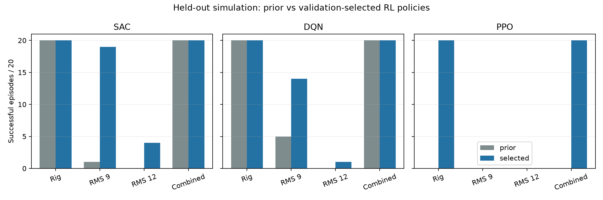

# Further RL tuning from the teammate's hardware diagnosis

Work is isolated on `rl/rig-training`; classical presets and hardware commands are unchanged.

## Teammate's changes and tuning method

Fetched `origin/param/v1` through `9ee697f`; it adds four commits after the common base
`6a88824`, while our first RL continuation is `79023de`:

- `cf48c66`: replayed MPC hardware observations through LQR, compared commands,
  and grouped catches by early arm speed. Only 1/34 catches above 4.3 rad/s in
  the first 0.2 s held, versus 11/39 below that threshold. Added a stricter catch
  gate, later retired after 0/10 hardware attempts.
- `17f629e`: compared unexplained pendulum acceleration in hardware and simulation
  (about 16 versus 3 rad/s²), then introduced an AR(1) torque disturbance with
  acceleration RMS 9 rad/s² and tick correlation 0.3. Swept balance settings
  against that surrogate and checked the ordinary stress suite. MPC input
  penalty `r=3` passed 18/20 versus 4/20 for `r=30`; both passed 50/50 ordinary
  stress trials. Stronger angle/speed weights, different horizon/constraints,
  arm limits, recentering and observer settings were also compared. Turning off
  the observer helped at 15 ms but failed at 30 ms. The lower-r preset had not
  established hardware success in that commit.

- `e9db771`: the low-r gain made the first predicted balance command too large
  for the capture gate. Introduced `capture_r=30` to evaluate catches with the
  reference gain while balancing with `r=3`; replay accepted the same 10/99
  catches as the reference. Three earlier low-r hardware runs held at most
  0.44 s, despite good simulated results.
- `9ee697f`: three additional low-r runs with that capture fix held at most
  1.44 s. Both the disturbed simulator and a measured-response balance simulator
  still incorrectly rank `r=3` above `r=30`. The teammate therefore recommends
  keeping the original `r=30` transfer preset and repeating hardware trials.
  This invalidates treating the earlier simulator win as a hardware improvement.

This is hardware-log diagnosis followed by simulator parameter sweeps, not RL
training. The disturbance is a useful surrogate, not a physical noise bound, and the latest
hardware results show that its controller rankings may not transfer.
The teammate's published success counts use a different setup from this RL
experiment and are not direct head-to-head comparisons.

## RL continuation

Continue the already adapted PPO/DQN/SAC checkpoints, preserving the observation,
reward, action limiter and identified rig model. Sample disturbance RMS uniformly
from 0–12 rad/s² per episode; use correlation 0.3, delay 18 ms and planner speed
4.4 rad/s. Resets remain 25% exact hanging, 25% upright and 50% varied hanging.
The wrapper keeps its RNG advancing across unseeded training resets; an explicit
seed reproduces the sequence. No dependencies were added.

Round one uses seed 174 and learning rate 1e-4: 100,000 steps each for SAC/DQN,
131,072 for PPO. SAC/DQN collect 5,000 fresh transitions before updates because
the starting checkpoints contain no replay buffer. PPO gets a second 524,288-step
continuation with seed 275 and learning rate 3e-4 after round one fails validation.
SAC also gets 300,000 further steps and DQN 200,000 with seed 275 and learning
rate 1e-4, to test whether longer continuation recovers performance.
CPU execution uses one thread per process to coexist with other controller work.

Validation uses seeds 61000–61004 in four cases: varied identified rig, that rig
with RMS 9 or 12 disturbance, and the existing combined synthetic stress case.
All policies use the same limiter and 15-second assignment metric. Compare the
prior policies, round-one final policies, DQN/SAC 50k checkpoints, and the longer PPO/SAC/DQN final policies.
Rank candidates within each algorithm by fewer safety stops, then total passes,
then mean longest balance. Freeze selections before testing seeds 71000–71019.
Test results must not select another checkpoint. Preserve prior policies even
when a continuation is selected; simulation results do not establish hardware
performance.

Example reproduction (run from this checkout, using the existing RL environment):

```bash
export PYTHONPATH=src OMP_NUM_THREADS=1 MKL_NUM_THREADS=1
python scripts/train_rig_rl.py sac --checkpoint docs/results/rig_rl/sac/policy.zip \
  --steps 100000 --seed 174 --disturbance-rms 12 --learning-rate 0.0001 \
  --output runs/new_disturbance/sac
python scripts/eval_disturbed_rl.py \
  --policy prior:sac=docs/results/rig_rl/sac/policy.zip \
  --policy candidate:sac=runs/new_disturbance/sac/policy.zip \
  --episodes 5 --seed 61000 --output runs/new_disturbance/validation.json
```

Training metadata records source checkpoint hashes, steps and settings. Evaluation
JSON preserves every episode's metrics, checkpoint hashes and parameter/config
hashes. Always use fresh output paths.

## Frozen validation selection

1,355,360 additional training steps were completed: SAC 400,000, DQN 300,000,
PPO 655,360. An additional eight-step DQN run checked the training CLI; it was
not a candidate. All three longer final policies won the stated validation
ranking. No validation candidate triggered a safety stop.

| Candidate | Rig varied | RMS 9 | RMS 12 | Combined | Total |
| --- | ---: | ---: | ---: | ---: | ---: |
| SAC prior | 5/5 | 0/5 | 0/5 | 5/5 | 10/20 |
| SAC 50k | 5/5 | 2/5 | 0/5 | 5/5 | 12/20 |
| SAC 100k | 5/5 | 2/5 | 1/5 | 5/5 | 13/20 |
| SAC 400k, selected | 5/5 | 5/5 | 2/5 | 5/5 | 17/20 |
| DQN prior | 5/5 | 1/5 | 0/5 | 5/5 | 11/20 |
| DQN 50k | 0/5 | 1/5 | 0/5 | 3/5 | 4/20 |
| DQN 100k | 3/5 | 2/5 | 0/5 | 5/5 | 10/20 |
| DQN 300k, selected | 5/5 | 4/5 | 0/5 | 5/5 | 14/20 |
| PPO prior | 0/5 | 0/5 | 0/5 | 0/5 | 0/20 |
| PPO 131,072 | 0/5 | 0/5 | 0/5 | 0/5 | 0/20 |
| PPO 655,360, selected | 5/5 | 0/5 | 0/5 | 5/5 | 10/20 |

The [selection record](results/rig_rl_disturbance/selection.json) was written
before any seed-71000 test runs. These validation results informed selection;
they are not the final generalization estimates.

The archive at [results/rig_rl_disturbance](results/rig_rl_disturbance) contains
all evaluated new checkpoints, training metadata and validation reports.
Runtime paths in those reports retain their original `runs/disturbance_rl_v2`
prefix. Archived `sac`, `dqn`, `ppo`, `sac_long`, `dqn_long`, `ppo_long` directories
have the same final `policy.zip` files; intermediate checkpoints live under
`sac_50k` and `dqn_50k`. Checkpoint hashes identify them independently of paths.
The previous policies remain in `results/rig_rl`.

## Held-out result

Twenty new paired seeds (71000–71019) per scenario, two frozen policies per
algorithm: 480 episodes total. No test result changed checkpoint selection.

| Algorithm, prior → selected | Rig varied | RMS 9 | RMS 12 | Combined | Total |
| --- | ---: | ---: | ---: | ---: | ---: |
| SAC | 20 → 20 | 1 → 19 | 0 → 4 | 20 → 20 | 41/80 → 63/80 |
| DQN | 20 → 20 | 5 → 14 | 0 → 1 | 20 → 20 | 45/80 → 55/80 |
| PPO | 0 → 20 | 0 → 0 | 0 → 0 | 0 → 20 | 0/80 → 40/80 |

Each scenario column is out of 20. All 480 episodes had zero safety stops.
Maximum arm excursion across the selected policies was 80.35°. SAC's undisturbed
rig excursion increased from 56.28° to 69.97°; improved balance is not a uniform
reduction in motion. The 12 rad/s² disturbance remains a serious weakness.
SAC is the strongest candidate on this test distribution; PPO recovered ordinary
rig swing-up and balance but not disturbance rejection. These are results for
standalone learned controllers, not the SAC swing-up/classical-balance hybrid.



Final policies: [SAC](results/rig_rl_disturbance/sac_long/policy.zip),
[DQN](results/rig_rl_disturbance/dqn_long/policy.zip) with its
[action grid](results/rig_rl_disturbance/dqn_long/policy.zip.actions.json),
[PPO](results/rig_rl_disturbance/ppo_long/policy.zip).
Full episode metrics: [SAC](results/rig_rl_disturbance/test_sac.json),
[DQN](results/rig_rl_disturbance/test_dqn.json),
[PPO](results/rig_rl_disturbance/test_ppo.json).

Reproduce a final comparison, then render all three comparisons:

```bash
python scripts/eval_disturbed_rl.py \
  --policy sac_prior:sac=docs/results/rig_rl/sac/policy.zip \
  --policy sac_selected:sac=docs/results/rig_rl_disturbance/sac_long/policy.zip \
  --episodes 20 --seed 71000 --output runs/new_disturbance/test_sac.json
# Repeat with dqn and ppo, preserving the *_prior and *_selected labels.
python scripts/plot_disturbed_rl.py --results runs/new_disturbance \
  --output runs/new_disturbance/comparison.png
```

These test seeds become development data if used for future tuning. Another
independent test is needed then. This is a small simulation test with one
training sequence per algorithm, not an estimate of hardware success. In
particular, teammate commit `9ee697f` demonstrates that this surrogate can rank
controllers incorrectly on hardware. No hardware was operated, and deployment
presets were not changed.

## Verification

The four new regression tests pass: seeded disturbance reproduction and RNG
progression, torque/reset behavior, zero-disturbance trajectory equivalence,
invalid settings, and safety-prioritized selection are covered across those tests.
A DQN training CLI smoke run saved the continued checkpoint and action grid;
the full DQN candidates also reloaded successfully through the evaluation path.
The archived selected model hashes match the frozen selection exactly.

`OMP_NUM_THREADS=1 MKL_NUM_THREADS=1 PYTHONPATH=src python -m unittest discover -s tests`
ran 88 tests with one skip and three failures in the hardware-pass replay
subcases (maximum action discrepancy about 2.2e-6 against tolerance 1e-9).
All three failures were reproduced from an untouched archive of parent commit
`79023de`; their tolerance was not loosened. See
[full suite output](results/rig_rl_disturbance/tests_final.log) and
[parent replay output](results/rig_rl_disturbance/prior_replay_tests.log).
`git diff --check` passes. No dependency changes.
