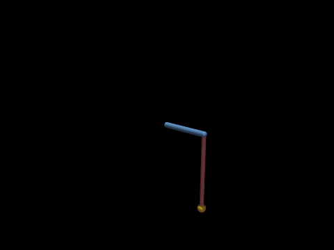
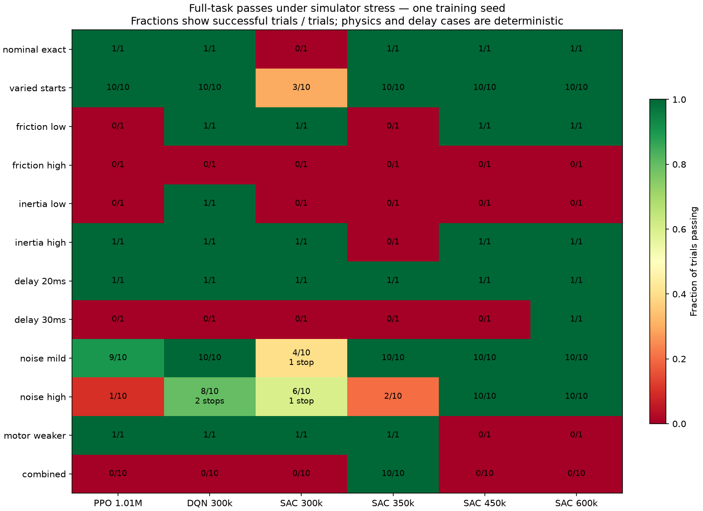
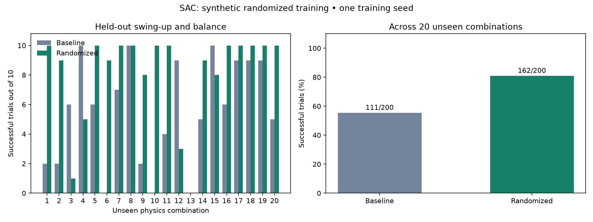
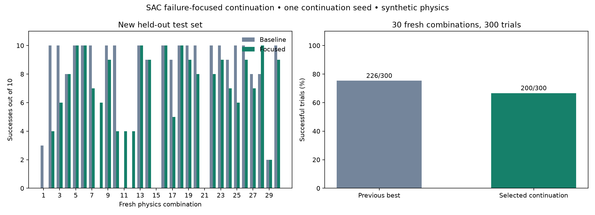
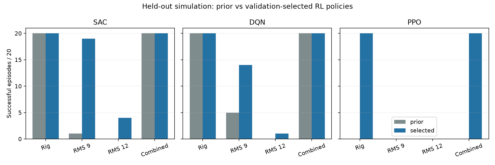

# RPL HW1 — Group 8

## Current status

**LQR passed the 15 s hanging-start task on the real rig** (3 of 16 attempts on
2026-11-07; best run 030202 held 12.84 s). See [LQR hardware pass](#lqr-hardware-pass-2026-11-07)
and the [evidence folder](docs/results/hardware/lqr/). MPC, iLQR and
PID now share the same swing-up and hand-off settings and pass in simulation;
their hardware runs are pending. [MATERIALS.md](MATERIALS.md) lists where every
file is. Algorithm implementation notes and the derivation
of the acceleration-input A/B matrices are in [docs/algorithms.md](docs/algorithms.md).
All seven required controllers have passed a nominal hanging-start simulation
trial; broader stress tests still show failures. See the
[reproduction guide](docs/reproducing-experiments.md) for network details, GPU setup,
commands, and the distinction between committed and local-only artifacts.

## Assembly (pending)

Add component photos, wiring/assembly progress, commissioning checklist results,
and final rig details.

## System identification (pending)

Add a video of the actual process, pendulum mass and geometry, free-swing data,
fitted friction/inertia, fit diagnostics, and validation experiments. Export
`configs/my_rig.json`; include uncertainty and model limitations.

## Controllers and comparison

The classical controllers use energy shaping with arm centering and a kick from
hanging rest, then switch to their own balance law. Capture and release use
hysteresis. PPO, SAC, and DQN use learned actions throughout, without a swing-up
helper. See the implementation notes for details and limitations.

| Algorithm | Simulator GIF | Real-world video | Full-task metrics |
| --- | --- | --- | --- |
| PID | Pending final evaluation | Pending | [Hardware pass, run 161650](docs/results/hardware/pid/) |
| LQR | Pending final evaluation | Run 030202 recorded (add link) | [4/18 hardware passes](docs/results/hardware/lqr/) |
| iLQR | Pending final evaluation | Pending | [Hardware pass, run 161026](docs/results/hardware/ilqr/) |
| MPC | Pending final evaluation | Pending | [Hardware pass, run 155613](docs/results/hardware/mpc/) |
| PPO | [Starter-model GIF](docs/results/ppo_learned.gif) | Pending | [Simulation results](docs/results/gpu_training.json) |
| SAC | [Continued-policy GIF](docs/results/sac_continued.gif) | Pending | [Continuation and robustness results](docs/results/robustness.json) |
| DQN | [Starter-model GIF](docs/results/dqn_learned.gif) | Pending | [Simulation results](docs/results/gpu_training.json) |

Real-pendulum runs for every algorithm are indexed in
[docs/results/hardware/](docs/results/hardware/README.md); [MATERIALS.md](MATERIALS.md)
maps each grading item to its files. Use side-by-side GIF/video links for each algorithm. Report run seeds, parameter
file, checkpoint/config, stop reason, balance duration, success rate, maximum arm
excursion, and robustness observations. Evaluate 15 s hanging-start episodes;
the whole final 10 s must satisfy |theta| <= 15 degrees and |theta_dot| <= 4 rad/s.
Near-upright trials are diagnostic and must be labeled separately.

### LQR on the identified rig

The LQR preset [with learned swing-up](configs/experiments/lqr_my_rig_learned_swing.json)
uses the [SAC checkpoint](docs/results/sac_focused_policy.zip) to approach upright.
After the capture gate accepts the state, delay-augmented Riccati feedback
balances the pendulum. SAC resumes swing-up if LQR releases. The preset blends
the firmware pendulum velocity with a derivative of recent angle samples and
limits the arm acceleration request in both phases to preserve braking room.
See the [model and controller details](docs/algorithms.md).
The 50 Hz LQR uses `Q = diag(2, 60, 1, 2)` for arm angle, pendulum angle,
arm speed, and pendulum speed, with zero direct weight on the queued input.
The pendulum angle has the largest weight. `R = 30` penalizes normalized
acceleration demand. With a modeled 15 ms input delay, the nominal discrete
closed-loop spectral radius is 0.9717 for the unconstrained linear model.

On `configs/my_rig.json`, the seed 0 hanging-start simulation passed the 15 s
metric. It balanced continuously for 12.90 s, reached 50.78° peak arm travel,
and stayed in LQR mode throughout the final 10 s. The separate upright-start
diagnostic passed 9 of 10 trials (seeds 10000–10009), with LQR active throughout
the final 10 s on each pass. Seed 10007 missed the LQR handoff. In the earlier
adaptive energy swing-up diagnostic, hardware run 09 held balance for 1.18 s
before falling.
Run 10 with filtered LQR and energy swing-up recorded 0.08 s of continuous
balance. Both were 8 s diagnostics.

In the 3 s learned-swing-up hardware diagnostic (run 11), the pendulum
crossed upright too quickly for the LQR capture gate. The approach included
commands that added energy after the pendulum had enough to reach upright.
The [braked swing-up preset](configs/experiments/lqr_my_rig_braked_swing.json) predicts
pendulum energy one 20 ms tick ahead under the previous motor command. On
an inward approach, it uses the remaining change in `sin(theta)` to
estimate the braking needed for a 4.5 rad/s crossing. It limits the
learned action only when that predicted energy is above target and logs the
original, braked, and final arm-limited commands separately. LQR continues
to supply the balancing commands after capture.
The braked preset passed 79 of 96 paired perturbed simulations, versus 75
for the earlier learned swing-up preset. On each pass LQR was active
throughout the final 10 s. Neither preset hit an arm guard in this batch.

Hardware runs 13 and 14 completed 15 s. Their first LQR handoffs occurred at
5.41 s and 6.63 s, and their longest continuous balance intervals were 1.18 s
and 1.10 s. Before several falls, LQR requested maximum acceleration in the
direction of arm motion and the arm limiter reduced the command near 4.7 rad/s.
The [recenter preset](configs/experiments/lqr_my_rig_recenter.json) starts with an arm
reference near the capture position and moves it toward center at 0.35 rad/s
while reported arm speed is below 3.6 rad/s. This separates the immediate
pendulum correction from the arm's return to center. In 99 held-out simulated
restarts from recorded handoff states, it reduced arm-limit interventions
from 435 to 368 and increased holds without a release from 78 to 81. Both
presets passed 79 of 96 separate full-task simulations. Hardware evaluation
of the recenter preset is pending.

A subsequent experiment tested velocity estimation separately from capture
and centering. A fixed 20 ms relative timing correction improved replay
prediction but reduced uninterrupted holds from 81 to 67 in 99 simulated
restarts from recorded handoff states. The [observer preset](configs/experiments/lqr_my_rig_observed.json)
instead estimates velocity from recent angle changes and arm-speed impulses
using actual firmware sample intervals. It bounds its influence and applies
it only after capture while the pendulum and arm are inside the balance
region. The offline 200 ms prediction error on run 14 fell from 17.95° RMS
with the prior blend to 16.62° RMS with the observer estimate. The two
presets each passed 70 of 96 new full-task simulations, with zero arm guard
stops. The observer reduced mean clipped commands in the two noisy,
lower-speed batches and recorded two additional releases overall. The
observer's effect on physical balance remains to be measured.

### LQR hardware pass (2026-11-07)

Preset [`lqr_my_rig_coupling_delay.json`](configs/lqr_my_rig_coupling_delay.json)
with rig model [`my_rig.json`](configs/my_rig.json) and SAC swing-up checkpoint
[`sac_focused_policy.zip`](docs/results/sac_focused_policy.zip). The code is git
tag `lqr-hw-pass-20261107`. SAC swings the pendulum up. LQR balances it with a
model of 15 ms arm and 25 ms pendulum input delay, R = 30, a velocity observer,
approach braking at 4.5 rad/s, arm recentering at 0.35 rad/s, and an arm
command limit of 4.7 rad/s and 1.42 rad.

**3 of 16 attempts passed** the full-task metric. One attempt stopped on an
encoder fault and one faulted before its first sample.

| Run | First LQR capture | Longest balance | Final 10 s max \|θ\| | Final 10 s max \|θ̇\| | Arm travel, whole run / final 10 s |
| --- | ---: | ---: | ---: | ---: | ---: |
| 025738 | 3.09 s | 11.92 s | 4.74° | 2.07 rad/s | 60.7° / 16.8° |
| 025856 | 2.05 s | 11.10 s | 4.57° | 2.82 rad/s | 81.6° / 12.3° |
| **030202 (filmed)** | 2.09 s | **12.84 s** | 7.82° | 3.16 rad/s | 80.4° / 22.7° |

The largest arm travel occurs during swing-up; once LQR holds, the arm stays
within 23° of center. Run 025856 released and recaptured twice before
holding. The other two held from their first capture. The
[run index](docs/results/hardware/lqr/README.md) lists every
attempt. [`tests/test_hardware_replay.py`](tests/test_hardware_replay.py)
replays the recorded observations of the three passes and requires the current
code to reproduce every command the rig was sent.

### Transferring the LQR setup to MPC, iLQR and PID

The swing-up, capture gate, approach braking, velocity observer, arm
recentering and arm limiter are one block of code. LQR, MPC, iLQR and PID
each keep an identical copy, because the assignment keeps each algorithm in
its own file. A test checks the copies match. Each transfer preset copies the
LQR hand-off settings and arm limits unchanged and keeps its own balance gains.
See the [settings reference](docs/controller-settings.md).

| Algorithm | Preset | Balance model |
| --- | --- | --- |
| MPC | [`mpc_my_rig_transfer.json`](configs/mpc_my_rig_transfer.json) | Same 15/25 ms delay model as LQR; 8-tick horizon; arm constraints matched to the limiter |
| iLQR | [`ilqr_my_rig_transfer.json`](configs/ilqr_my_rig_transfer.json) | Nonlinear 4-state model with a 12 ms state prediction |
| PID | [`pid_my_rig_transfer.json`](configs/pid_my_rig_transfer.json) | Cascaded PID with a 12 ms state prediction |

All four pass the nominal 15 s hanging-start simulation. In a paired stress
batch ([results](docs/results/transfer_stress_20261107.json),
[script](scripts/transfer_stress.py)) with varied starts, 20 and 30 ms delay,
mild sensor noise and a combined case, 10 seeds each, LQR, MPC and iLQR passed
50/50 and PID passed 49/50, with no arm-guard stops. The LQR reference also
passes this batch but passed only 3 of 16 hardware attempts. The batch shows
that the transfer works in simulation. It does not predict hardware success.

#### MPC on hardware (2026-11-07)

The first five full MPC transfer attempts held at most 3.1 s
([runs](docs/results/hardware/mpc/README.md)). Replaying them offline showed
that MPC sent the same command LQR would have, within 0.02 on 90% of balance
ticks. It differed only after the arm had reached its travel limit, so MPC
fails where LQR fails. Across all 73 catches recorded with the LQR hand-off
settings (LQR and MPC), a catch almost never held once the arm passed
4.3 rad/s in the first 0.2 s: 1 of 34 did, against 11 of 39 that stayed slower.
Changing MPC's weights, horizon or arm constraints made no
difference when the plain simulator was started from the recorded catch states
(that simulator turned out to be too calm; see below), and
a horizon of 25 ticks took up to 31 ms, longer than the 20 ms control period.

A first fix, [`experiments/mpc_my_rig_strict_catch.json`](configs/experiments/mpc_my_rig_strict_catch.json),
rejected catches with the arm moving faster than 2.5 rad/s or a first command
above 0.7. On the rig it did not help: 0 of 10 attempts, best hold 5.9 s.
[`scripts/catch_report.py`](scripts/catch_report.py) reproduces the catch
table and rule scores.

#### Why the simulator was optimistic

A closer look at all recorded balance data:

- **The software and sensing are not the problem.** Replay reproduces every
  command; the velocity observer tracks the pendulum's true speed within
  0.2–0.3 rad/s with no bias or lag; a still pendulum reads within 1 encoder
  count (0.08°).
- **The model's constants are close.** Fitting the balance data gives a
  gravity term of 139–147 s⁻² (model 150), an arm-to-pendulum coupling of
  0.98 (model 1.00), an arm delay of about 15 ms and a pendulum delay of about
  23 ms (model 15 and 25 ms). In the linear model, LQR stays stable for
  coupling errors of ±40% and up to about 40 ms of pendulum delay.
- **Every fall ends with the arm at its speed limit.** In all 38 falls of the
  newest MPC and iLQR attempts the arm reached 4.5–4.8 rad/s in the last
  0.3 s.
- **Even the passes wobble.** In passing LQR holds the pendulum moved about
  ±3° at about 1 Hz and the arm reached 4.1–4.7 rad/s. In the simulator the
  same controller holds within 0.2° and the arm stays below 0.4 rad/s.
- **The cause is an unmodelled disturbance.** During balance the real
  pendulum has 16 rad/s² (robust RMS) of acceleration the model does not
  explain, against 3 rad/s² in simulation. It is real motion, not sensor
  noise: its sample-to-sample correlation is +0.33, where encoder noise would
  give −0.67. It does not follow command changes or arm reversals. About 5%
  of ticks are much larger kicks, consistent with the pendulum being touched
  during some runs.

Adding a random pendulum acceleration of 9 rad/s² RMS and a 15 ms command
delay to the simulator ([`scripts/disturbance_sim.py`](scripts/disturbance_sim.py))
reproduces the rig: the LQR reference passes 4 of 20, with a 4° wobble, the
arm peaking at 4.7 rad/s and command RMS 0.4.

#### Lower input weight for MPC

In that calibrated simulator the input weight `r` is the setting that
matters. With `r` = 30 the controller corrects a lean slowly, gravity keeps
accelerating the pendulum meanwhile, and the arm needs more speed to catch up
than the 4.7 rad/s limit allows. With `r` = 3 it corrects sooner and needs
less arm speed. Passes in 20 calibrated episodes:

| MPC preset | Calibrated sim, 9 rad/s² | 6 rad/s², 15 ms | 12 rad/s², 15 ms | 6 rad/s², 30 ms | Standard stress batch |
| --- | --- | --- | --- | --- | --- |
| `mpc_my_rig_transfer.json` (`r` = 30) | 4/20 | 16/20* | 0/20* | 19/20* | 50/50 |
| [`mpc_my_rig_low_r.json`](configs/mpc_my_rig_low_r.json) (`r` = 3) | **18/20** | 18/20* | 4/20* | 15/20* | 50/50 |

\* Run with the LQR balance law, which uses the same weights; MPC matched
LQR within 0.02 on recorded states.

Other changes tried in the calibrated simulator did less: a stronger
pendulum-angle weight (5–11 of 20), an arm-speed weight (7/20), a 4.9 rad/s
arm limit (6/20), no recentering (4/20), a 15-tick horizon with a 4.3 rad/s
speed constraint (12/20). Turning the observer off helped at 15 ms of delay
but failed at 30 ms, so it stays on. `r` = 3 costs some margin if the real
delay is 15 ms longer than measured. MPC with `r` = 3 solves in at most
1.3 ms.

The first three hardware attempts with `r` = 3 (2026-11-07, 15:38–15:39)
held at most 0.44 s and the pendulum spun 6–20 full turns per run. The cause
was the catch check, not the balance: `capture_max_action` limits the first
balance command to 1.0, and with `r` = 3 that command near upright is 5–7, so
only 6 of 129 catch chances were taken and the pendulum kept passing over the
top. The preset now sets `capture_r` = 30, which computes that first command
with the hardware-tested gains and then balances with `r` = 3. On the recorded
states it accepts exactly the catches the `r` = 30 preset accepts (10 of 99),
and it still passes 17 of 20 in the calibrated simulator (4 of 20 for
`r` = 30). Spinning follows failed catches and falls: after a fall the
pendulum has a lot of energy, and during swing-up the arm limiter cuts
commands about twice as often on the left as on the right, so the swing-up
cannot always brake it.

#### Result: keep `r` = 30 (2026-11-07)

Three more attempts with `capture_r` caught 3–5 times each but held at most
1.44 s; with `r` = 3 the controller ran at full strength for most of each hold
and the arm reached its speed limit. Neither the calibrated simulator nor a
balance simulator built from the measured real command response (with the
encoder's 0.088° steps and the firmware's 8 ms velocity window) reproduces
that: both still rank `r` = 3 above `r` = 30. These simulators match the rig
for `r` = 30 but cannot be trusted to choose other gains.

The `r` = 30 MPC preset is the passing LQR controller. Replaying the four LQR
passes through [`mpc_my_rig_transfer.json`](configs/mpc_my_rig_transfer.json)
gives the same catch and release decisions and the same commands within 0.004
on 99% of balance ticks. Its 0 of 5 so far is consistent with the LQR
hardware rate of about 22% (0 of 5 happens 29% of the time). Run it again
rather than retuning; 10 attempts give a 92% chance of at least one pass at
that rate.

### MPC hardware pass (2026-11-07)

Run [`20261107_155613`](docs/results/hardware/mpc/20261107_155613/) passed
with [`mpc_my_rig_transfer.json`](configs/mpc_my_rig_transfer.json), the
ninth full 15 s attempt with that preset (12 started). SAC swung the pendulum up, MPC caught it once
at 4.23 s and held it to the end: 10.66 s of continuous balance, with the final
10 s within 5.89° and 1.33 rad/s of upright and the arm within 29° of center.
Replaying the recorded observations through the current code reproduces every
command. The preset carries the LQR hand-off settings and weights unchanged,
and on the four LQR passes it makes the same catch and release decisions and
the same commands within 0.004, so this result is the LQR setup running as
constrained MPC. The other MPC presets tried that day (strict catch 0 of 10,
`r` = 3 0 of 6) did not pass.

### Matching PID and iLQR to the LQR pass

MPC passed once its preset sent LQR's commands, so PID and iLQR were given the
same property. On the recorded LQR pass the old transfer presets differed from
LQR's commands by 0.09 at the median (catch and release matched in 1 of 4
passes); the new presets match within 0.01 (iLQR 0.02) at the 99th percentile
and make the same catch and release decisions in all four passes. Both pass
50/50 in the standard simulator stress batch.

- **iLQR** ([`ilqr_my_rig_lqr_match.json`](configs/ilqr_my_rig_lqr_match.json))
  now accepts `delay` and `pendulum_input_delay_s`. Its model is LQR's
  delay-augmented model with the nonlinear terms of the course model added
  (gravity beyond the small-angle term and the arm-speed term
  sin θ cos θ φ̇²). It still linearizes along a nominal trajectory and runs
  backward and forward passes (2 iterations, at most 4.5 ms per tick). Near
  upright the nonlinear terms are small, so iLQR converges to the LQR answer
  for the same Q and R, as it should; it departs by up to 0.09 at larger
  angles.
- **PID** ([`pid_my_rig_lqr_match.json`](configs/pid_my_rig_lqr_match.json))
  keeps its cascaded form, u = −(Kp e + Ki ∫e + Kd ė) with
  e = θ − (arm_kp φ + arm_kd φ̇), and gains a delay predictor in front of it:
  the state is predicted two ticks ahead, until the commands still in flight
  have acted (the idea of a Smith predictor). The gains were found from the
  LQR solution: the LQR gain on the delay-augmented state equals a state
  feedback on that predicted state exactly, which gives Kp = 399.6,
  Kd = 33.27, arm_kp = 0.0224 and arm_kd = 0.0217. Ki = 10 adds an integral
  on the angle error; it changes commands by at most 0.004 on the pass.

Neither change touches the shared swing-up and hand-off block, and each
algorithm still computes its own balance command in its own file, as the
assignment requires (slide 13: the algorithm being graded must do the
balancing). The cost is that PID's gains are derived from LQR rather than
tuned by hand, which this report states openly.

### iLQR hardware pass (2026-11-07)

Run [`20261107_161026`](docs/results/hardware/ilqr/20261107_161026/) passed
with [`ilqr_my_rig_lqr_match.json`](configs/ilqr_my_rig_lqr_match.json), the
fifth attempt with that preset. SAC swung the pendulum up, iLQR caught it once
at 1.67 s and held it to the end: 13.26 s of continuous balance, the longest
of any hardware pass so far, with the final 10 s within 1.49° and 0.95 rad/s
of upright and the arm within 23° of center. Replaying the recorded
observations reproduces every command. iLQR took at most 7.6 ms per tick
(20 ms period). Two of the four failed attempts with this preset held 6.5 s.

PID with [`pid_my_rig_lqr_match.json`](configs/pid_my_rig_lqr_match.json)
failed its first three attempts (best hold 2.84 s). Replaying those runs
through LQR gives the same catch and release decisions and the same commands
within 0.01, so they are the same kind of failed catch the LQR setup has about
three times in four, not a fault in the PID law.

### PID hardware pass (2026-11-07)

Run [`20261107_161650`](docs/results/hardware/pid/20261107_161650/) passed
with [`pid_my_rig_lqr_match.json`](configs/pid_my_rig_lqr_match.json), the
seventh attempt with that preset. SAC swung the pendulum up, the PID loop
caught it once at 4.29 s and held it to the end: 10.42 s of continuous
balance, with the final 10 s within 2.38° and 0.95 rad/s of upright and the
arm within 20° of center. Replaying the recorded observations reproduces
every command. Two earlier attempts with the preset held 6.2 s and 8.3 s.
On all seven attempts LQR would have sent the same commands within 0.005 at
the 99th percentile. The PID gains come from the LQR solution, as described
in [Matching PID and iLQR to the LQR pass](#matching-pid-and-ilqr-to-the-lqr-pass).

With this run all four classical controllers have passed on hardware.

## Preliminary simulator results (2026-10-16)

These are development results on **synthetic starter parameters**, with one
15 s exact hanging-start trial per classical algorithm and seed 0. All four
completed without a safety stop and met the final-10-second criterion. Each had
11.6 s of continuous balance and 84.66 degrees maximum arm excursion. Exact
hanging resets are deterministic; this is not a multi-seed robustness study.

[Machine-readable metrics and parameter hash](docs/results/starter_baselines.json).
Traces: [PID](docs/results/pid_starter_trace.npz),
[LQR](docs/results/lqr_starter_trace.npz),
[iLQR](docs/results/ilqr_starter_trace.npz),
[MPC](docs/results/mpc_starter_trace.npz).

The regression suite also trains each learned controller for only 32 steps and
checks deterministic checkpoint reloads. Those checkpoints are temporary test
artifacts and do **not** demonstrate learned swing-up or balance.

## GPU learning experiments (2026-10-16)

Training used an RTX 4070 Ti, fixed observation scaling stored inside the
network, and positive training-reward scaling. PPO collected actions on CPU and
optimized batches on CUDA; SAC and DQN used CUDA directly. All used the supplied
synthetic starter physics and seed 0 with mixed hanging/upright training starts.
The learned policies have no classical swing-up helper.

| Algorithm | Actual steps | Training time | Exact hanging full-task success | Near-upright diagnostics | Varied hanging starts |
| --- | ---: | ---: | --- | --- | --- |
| PPO | 1,007,616 | 6 min 8 s | Pass; 11.80 s continuous balance | 5/5 pass | 20/20 pass |
| SAC | 300,000 | 12 min 52 s | Fail; 1.64 s continuous balance | 5/5 pass | Not evaluated |
| DQN | 300,000 | 5 min 36 s | Pass; 12.56 s continuous balance | 5/5 pass | 20/20 pass |

Exact hanging evaluation is one deterministic 15 s trial per final policy.
Near-upright diagnostics use seeds 10000–10004 and do not substitute for
hanging-start success. The extra varied-start trials use seeds 20000–20019,
pendulum offsets within +/-0.05 rad from hanging, arm offsets within +/-5 degrees,
and zero initial velocities. No safety stops occurred in these final-policy
trials. This is one training seed and small initial-state variation, not a study
of parameter uncertainty or hardware transfer. Jobs overlapped, so these times
are not isolated CPU/GPU benchmarks. The initial slow fully-CUDA PPO prototype
was stopped and restarted; its time is excluded above.

[Detailed metrics and intermediate checkpoints](docs/results/gpu_training.json).
[Learning curves](docs/results/gpu_learning_curves.png) show returns converted
back to the original reward units; improved return alone does not establish
success. At this initial 300,000-step stage, SAC still needed swing-up learning;
the later continuation below solved the nominal hanging-start task.

Exact configurations: [PPO](configs/ppo_gpu.json), [SAC](configs/sac_gpu.json),
[DQN](configs/dqn_gpu.json). Final policies and DQN's action-grid sidecar are
saved locally under `runs/gpu_rl_20261016/` in `ppo_hybrid_train`, `sac_train`, and
`dqn_train`. Selected checkpoints are explicitly included in Git despite the default ignore
rules; temporary runs and replay buffers remain local. See the checkpoint table below. All results here are simulator results;
physical videos and real-rig validation remain pending.

## SAC continuation and robustness validation (2026-10-16)

SAC continued from 300,000 to **600,000 total steps** on the RTX 4070 Ti,
adding 300,000 transitions in about **13 min 35 s**. The old checkpoint lacked a
replay buffer; weights/optimizer were restored and 10,000 fresh transitions were
collected before updates. This run saves final and intermediate replay buffers
for future continuation. Training physics and reward settings were unchanged;
no domain randomization or hardware experience was added.

The final policy passes the exact hanging-start 15 s task with **12.04 s** of
continuous balance. It also passes **20/20** extra varied hanging starts, seeds
40000–40019, without safety stops. These are independent of the checkpoint
comparison's evaluation seeds, but still use the same synthetic model.

[Continued SAC GIF](docs/results/sac_continued.gif),
[true-state trace](docs/results/sac_continued_trace.npz),
[extra varied-start metrics](docs/results/sac_continued_holdout.json).

The robustness suite compares PPO/DQN baselines and four SAC versions across
12 scenarios. Deterministic exact-start physics/delay cases have one trial;
noise and varied-start cases have ten. Bounds are chosen synthetic stress tests,
not measured hardware uncertainty. Checkpoint comparisons use seeds 30000–30009.

[Full metrics, configurations, checkpoint hashes and action timings](docs/results/robustness.json).
Final SAC passed both tested delay cases (20/30 ms) and all ten trials at each
noise level. It failed the +50% friction, -20% inertia, weaker-motor, and combined
cases. The 350,000-step checkpoint passed the combined case but had other
failures; the 450,000-step checkpoint improved noise tolerance. All checkpoints
are retained because continued nominal training does not monotonically improve
robustness. Success in one combined case does not imply tolerance of its
individual components.

No final-SAC stress or extra-start trial triggered a safety stop. Some baseline
policies did stop under noise; those failures are included in the matrix. The
measured CPU action-computation times were below 20 ms in these runs, but omit
USB IO and whole-loop scheduling. Hardware timing and transfer remain pending.

Final continued model: `runs/sac_robustness_20261016/train/policy.zip`.
Replay: `runs/sac_robustness_20261016/train/replay_buffer.pkl`.
The earlier successful policy and replay snapshots remain under `train/checkpoints/`.
The continuation config is [configs/sac_continue_gpu.json](configs/sac_continue_gpu.json).

Next, identify the assembled rig and validate the model. The failed stress cases
motivate training with parameter/delay/noise variation around measured ranges;
the tests alone do not correct those weaknesses. The regression suite now has
58 passing tests, including noise-history consistency, unchanged physical truth,
parameter isolation, and replay-buffer continuation. Source/wheel builds pass.

## Saved checkpoints

These selected model files are included on the review branch. Temporary runs,
training logs and replay buffers remain ignored; replay buffers are local and
can be regenerated through fresh simulation experience when resuming.

| Model | Checkpoint |
| --- | --- |
| PPO, 1,007,616 steps | [policy.zip](runs/gpu_rl_20261016/ppo_hybrid_train/policy.zip) |
| DQN, 300,000 steps | [policy.zip](runs/gpu_rl_20261016/dqn_train/policy.zip), required [action grid](runs/gpu_rl_20261016/dqn_train/policy.zip.actions.json) |
| SAC, 300,000-step baseline | [policy.zip](runs/gpu_rl_20261016/sac_train/policy.zip) |
| SAC, 350,000-step comparison | [checkpoint](runs/sac_robustness_20261016/train/checkpoints/sac_350000_steps.zip) |
| SAC, 450,000-step comparison | [checkpoint](runs/sac_robustness_20261016/train/checkpoints/sac_450000_steps.zip) |
| SAC, 600,000-step final | [policy.zip](runs/sac_robustness_20261016/train/policy.zip) |

## AI usage and reflection (draft log)

On 2026-10-16, we asked Codex to help build the algorithm portion while hardware
assembly was incomplete. Codex read the assignment and repository, implemented
initial classical controllers and SB3 training/checkpoint paths, and added tests
and simulation instructions. Validation included controller contracts, analytic
linear stability, nonlinear-model linearization, and short RL checkpoint round
trips. The initial PID gains were inadequate and were revised after simulation;
initial swing-up settings also required tuning. Small-angle balance and short
training smoke tests do not prove full-task performance or hardware transfer.

A subsequent request asked to train with the GPU. Codex added optional input/reward
scaling, validated GPU updates and CPU checkpoint loading, and trained/evaluated
PPO, SAC, and DQN. The failed SAC hanging-start result was retained alongside its
successful balance diagnostics. The updated regression suite passed 53 tests,
and source and wheel builds completed.

A further request was: “can you keep training SAC and do the robustness tests
while we finish soldering? use my GPU”. SAC was continued to 600,000 steps.
The earlier replay buffer was absent, so continuation restored weights/optimizer
and collected new experience before updates; later replay buffers were saved.
Robustness checks exposed failures hidden by nominal success, and successive
checkpoints showed different strengths. The updated suite passed 58 tests.

Representative requests included “can you simulate and learn those? use my GPU?”
and “its RL so its a network right? what does the network look like?”. The AI
inspected the saved networks and distinguished fixed-weight feedback during
deployment from ongoing learning. The architecture, configs, failure cases and
validation outputs are recorded so the team can inspect these claims.

Team members: add representative interaction excerpts, explain the derivation
and controller decisions in your own words, and record what you independently
verified or corrected. Add failures and lessons from real experiments.

## Live demonstration (pending)

Select the best controller after identified-rig tests and attended hardware
validation. Record recovery from perturbations and timing of the two demo runs.

## Randomized SAC training and unseen-combination tests (2026-10-22)

SAC received **600,000 additional simulation steps on the NVIDIA RTX 4070 Ti**,
warm-starting the previous 600,000-step policy and reaching 1,200,000 total
steps. Training took approximately 38 minutes. New training seed: 73. Nominal
replay was discarded and 10,000 fresh transitions were gathered before updates.
The existing reward, observation interface, and arm/speed safety guards were
retained. Each episode sampled independent uniform settings for friction
(×0.5–1.5), pivot inertia (×0.8–1.2), command delay (10–30 ms), motor acceleration
cap (40–50 rad/s²), planner speed cap (4–5 rad/s), angle-noise standard deviation
(0–0.01 rad), and velocity-noise standard deviation (0–0.3 rad/s). These bounds
are provisional synthetic assumptions, not measured hardware uncertainty.

Eight validation combinations with three hanging-start trials each selected
among the six periodic checkpoints and final policy. Selection ranked successes,
then fewer safety stops, then mean longest balance. The selected periodic
1,200,000-step checkpoint passed **21/24**, with no validation safety stops;
the original policy passed **11/24**. Other checkpoints did trigger validation
arm guards, so these results do not imply every training stage was equally safe.
The final ZIP and final periodic ZIP are distinct snapshots: the periodic
callback saves before the last gradient update.

The selected model was then frozen and tested on **20 independent physics
combinations, ten trials each**, using a separate seed stream. No final test
result was used for checkpoint selection. Each trial lasts 15 seconds and must
remain within 15° of upright with pendulum speed at most 4 rad/s throughout the
last ten seconds to succeed. The baseline uses exactly the same test settings,
starting seeds, noise seeds and success metric.

| Final test | Original SAC | Randomized SAC |
| --- | --- | --- |
| Unseen combinations | 111/200 (55.5%) | **162/200 (81.0%)** |
| Original combined stress case | 0/10 | **10/10** |
| Exact nominal hanging start | 1/1 | 1/1 |
| Safety stops across all 211 final trials per policy | 0 | 0 |
| Maximum arm travel across unseen combinations | 97.70° | 94.99° |

The aggregate gain is 25.5 percentage points. It is not uniform: the randomized
policy regresses on some cases and scores 0/10 on `unseen_12`, 1/10 on
`unseen_02`, and 3/10 on `unseen_11`. These remain failures, despite no guard
activation in final testing. One training seed and 20 sampled parameter
combinations do not establish hardware reliability or the probability of
successful transfer. After assembly, identify the rig, evaluate this frozen
policy against the identified model, and refine training ranges as needed before
attended physical trials.

Preserved artifacts: [selected policy](docs/results/sac_randomized_policy.zip),
[full comparison, hashes, selection and configuration](docs/results/sac_randomized_20261022.json),
and [plot](docs/results/sac_randomized_comparison.png). Raw episode traces,
per-episode sampled settings, training logs, and intermediate policies remain
under `runs/sac_randomized_20261022/`. Reproduction is documented in
[the experiment guide](docs/reproducing-experiments.md#randomized-sac-experiment-2026-10-22)
and [configuration](configs/sac_randomized_gpu.json). No dependencies were added.
The regression suite passed 62 tests; additional focused checks confirmed that
randomized inertia/friction reach the plant and the base parameter file is
unchanged. No physical hardware was connected or operated for this experiment.

## Failure-focused SAC continuation (2026-10-22)

A further **300,000 CUDA training steps** on the RTX 4070 Ti continued the
preserved randomized SAC policy from 1.2 to 1.5 million total steps (continuation
seed 174). The nine physics combinations with any failures in the previous
200-trial test became training anchors, weighted by their failure counts.
Episodes used 25% exact anchors, 40% nearby Gaussian perturbations (standard
deviation 8% of each parameter's original range, clipped to those bounds), and
35% broad uniform randomization. Starts were 20% upright, 10% exact hanging and
70% perturbed hanging. There was no reward change, dependency addition, physical
hardware interaction, or change to the simulation safety envelope. Nominal
replay was unavailable, so 10,000 fresh transitions preceded updates. Replay
buffers are saved locally for this run and its checkpoints.

The previous test combinations now inform training and are **diagnostics, not
held-out evidence**. A new validation set contained six broad and six near-anchor
combinations, five trials each. Checkpoint selection ranked fewer safety stops,
more successes, then longer mean balance. The starting policy scored 33/60;
periodic checkpoints at 1.3/1.4/1.5 million steps scored 1/60, 40/60 and 39/60,
respectively. The final post-update policy scored **42/60**, with zero guard
activations, and was selected before the fresh test. This substantial early
regression and later recovery are retained rather than omitted.

The selected continuation and starting policy were then frozen and evaluated on
**30 freshly sampled broad physics combinations, ten trials each**. These
combinations and episode/noise seeds were distinct from training/validation;
no fresh-test result selected or tuned checkpoints. Diagnostic checks separately
revisited the nine training anchors with new reset/noise seeds, the nominal
setup and the original combined stress case. All trials use the existing
truth-based final-ten-second success metric.

| Final comparison | Previous randomized policy | Focused continuation |
| --- | --- | --- |
| Fresh unseen combinations | **226/300 (75.3%)** | 200/300 (66.7%) |
| Nine previous failure combinations, new reset/noise seeds | 52/90 (57.8%) | **70/90 (77.8%)** |
| Original combined stress case | **10/10** | 1/10 |
| Exact nominal hanging start | 1/1 | 1/1 |
| Safety stops across all 401 final trials per policy | 0 | 0 |
| Maximum arm travel on fresh unseen combinations | 97.00° | 79.72° |

Focused sampling improved the targeted diagnostic success rate by 20 percentage
points, but fresh broad success fell by 8.7 points and the original combined
case regressed sharply. Lower arm travel does not offset those balance failures.
**Keep the previous randomized policy as the stronger general candidate.** The
focused model is preserved as an experimental result, not promoted as an overall
improvement. Validation improvement did not generalize uniformly, illustrating
why the separate fresh test was necessary. The old experiment's 81% and this
experiment's 75.3% baseline concern different test sets and should not be treated
as a change in the frozen baseline itself.

Only one continuation seed was trained. These synthetic ranges remain
uncalibrated and no hardware reliability is established. Any further tuning
informed by this fresh test needs another independent final test set. After
assembly, identify the rig and assess both models against measured physics
before deciding whether either is suitable for attended hardware trials.

Artifacts: [focused experimental policy](docs/results/sac_focused_policy.zip),
[full results, selection, hashes and training settings](docs/results/sac_focused_20261022.json),
[plot](docs/results/sac_focused_comparison.png), and
[configuration](configs/sac_focused_gpu.json). The
[previous general candidate](docs/results/sac_randomized_policy.zip) is retained.
Raw training physics logs, episode traces, checkpoints and replay buffers remain
under `runs/sac_focused_20261022/`. See the
[reproduction guide](docs/reproducing-experiments.md#failure-focused-sac-continuation-2026-10-22).
The 65-test regression suite passed, including focused-sampling bounds,
reproducibility, reset configuration, and safety-prioritized selection checks.

## Identified-rig RL disturbance continuation (2026-11-07)

A further 1,355,360 CPU training steps continued the previously adapted standalone
SAC, DQN and PPO policies with per-episode randomized pendulum disturbances.
This follows the teammate's hardware-log diagnosis through `9ee697f`, including
his finding that the simulated low-r MPC improvement did not transfer to hardware.
Validation selected the longer continuation for each algorithm before a separate
480-episode paired simulation test.

| Policy | Rig varied, prior → new | RMS 9, prior → new | RMS 12, prior → new | Combined, prior → new |
| --- | ---: | ---: | ---: | ---: |
| SAC | 20/20 → 20/20 | 1/20 → 19/20 | 0/20 → 4/20 | 20/20 → 20/20 |
| DQN | 20/20 → 20/20 | 5/20 → 14/20 | 0/20 → 1/20 | 20/20 → 20/20 |
| PPO | 0/20 → 20/20 | 0/20 → 0/20 | 0/20 → 0/20 | 0/20 → 20/20 |

No safety stops occurred. Strong disturbance remains a weakness; improved
simulation performance is not hardware validation. No deployment preset changed.
The [experiment report](docs/rl-disturbance-tuning.md) records the teammate's
methods, failed and successful continuations, selection rule, reproduction
commands, checkpoints, per-episode test results and existing replay-test failures.

### First standalone SAC attempts on hardware (2026-11-07)

The selected SAC policy (`rig_rl_disturbance/sac_long`) ran four times on the
rig with `configs/sac_my_rig.json` ([runs](docs/results/hardware/sac/README.md)).
None passed; the best held 1.50 s. Replay reproduces every command. In the
three complete runs the policy reached upright at 2.3–3.1 s but the pendulum
went over the top 12–14 times per run, and while upright 11–40% of commands
were at full strength. In the disturbance simulator the same policy swings up
once, holds, and uses full strength 3% of the time. A fourth run was stopped
by hand: the pendulum reading stayed at 179.9° while the arm swung at
±4 rad/s, so the encoder stalled or the pendulum was held.

The driven motor sweeps in [`docs/results/sysid/driven/`](docs/results/sysid/driven/)
were used to look for the gap. The arm delivers the commanded acceleration
(50–53 rad/s² for 50 commanded). Driving a pendulum model with the measured arm
motion reduces the pendulum-angle error over the sweeps from 12.7° with the
simulator's values to 5.0°, with coupling 0.85 of the model (the toolkit's
coupling fit gave 0.93) and viscous damping 1.0 s⁻¹ while the arm moves,
against 0.22 s⁻¹ from the free swing with the arm still. Neither these values
nor intermediate ones (coupling 0.88–0.92, damping 0.45–0.65 s⁻¹) made the
simulator reproduce both hardware outcomes: SAC spinning and failing, and the
LQR setup passing about one attempt in four. Large damping stopped SAC from
swinging up at all; coupling 0.85 made the LQR setup spin instead of SAC. So
the swing-up gap is not explained by delay, coupling or damping alone, and
the simulator was not changed.
